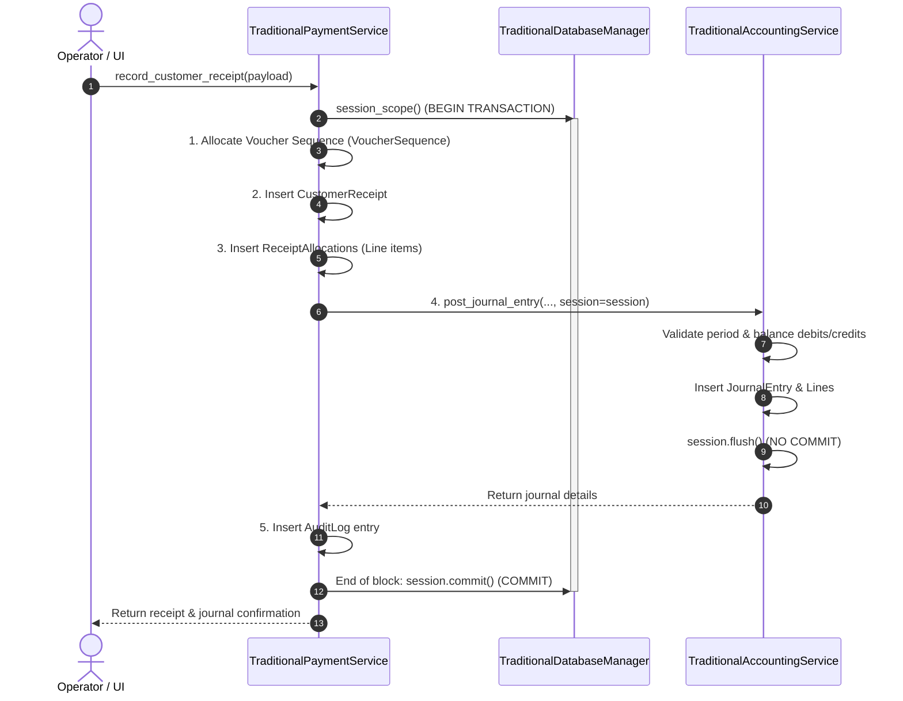
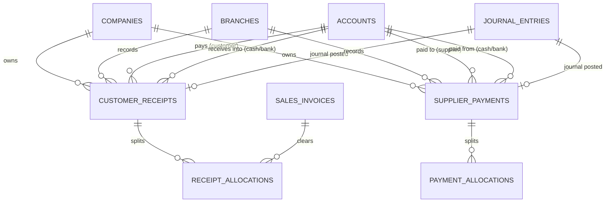
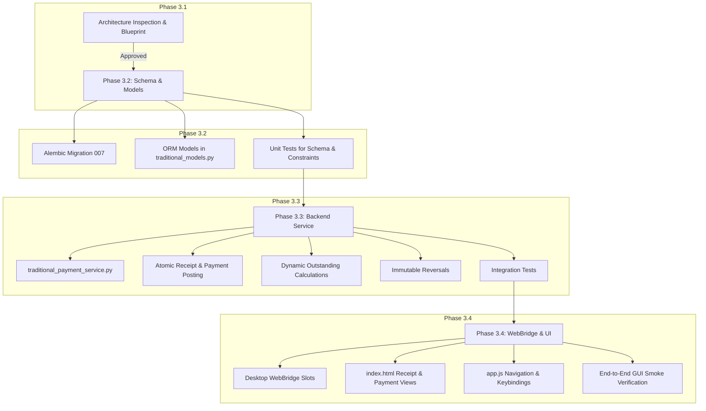

# Anti-Matrix Billing V2 — Phase 3.1: Payment & Receipt Management Architecture Blueprint

**Document Version:** 1.0.0  
**Phase:** 3.1 (Architecture Inspection & Technical Blueprint)  
**Author:** Senior ERP Backend Architect  
**Status:** Approved for Implementation (Read-Only Blueprint)  
**Date:** 2026-11-17  

---

## Executive Summary

Phase 3 of Anti-Matrix Billing V2 focuses on **Payment & Receipt Management** for Traditional Billing. This document presents a comprehensive, verified architectural blueprint based on a read-only inspection of the repository.

Traditional Billing uses a physically isolated SQLite database (`data/traditional_billing.db`) managed through SQLAlchemy ORM models (`db/traditional_models.py`) and a dedicated session manager (`TraditionalDatabaseManager` in `db/traditional_database.py`). It enforces strict physical and logical separation from Fast Billing (`data/anti_matrix_billing.db`).

The accounting engine (`services/traditional_accounting_service.py`), completed in Phase 2 & 2.1, provides full double-entry ledger capabilities, including Chart of Accounts, Journal Entries, Audit Logging, and period validation. The primary goal of Phase 3 is to build on this foundation by introducing:
1. **Customer Receipts & Allocations**: Managing receipts against debtor accounts, allocating payments to specific sales invoices or advances, handling cash discounts, and creating balanced double-entry accounting journals atomically.
2. **Supplier Payments & Allocations**: Managing payments to creditor accounts, allocating payments to purchase bills or advances, handling discounts received, and posting balanced double-entry journals atomically.
3. **Decoupled Architecture**: Seamlessly integrating with Friend 1's Sales module and preparing clean extension points for Friend 2's upcoming Traditional Purchase module without breaking ownership boundaries.

---

## 1. Existing Architecture & File References

### 1.1 Dual-Engine Physical Separation Invariant

| Attribute | Fast Billing (POS) | Traditional Billing (ERP) |
| :--- | :--- | :--- |
| **Database File** | `data/anti_matrix_billing.db` | `data/traditional_billing.db` |
| **Database Manager** | `db/database.py` (`db_manager`) | `db/traditional_database.py` (`traditional_db_manager`) |
| **ORM Base** | `db/models.py` (`Base`) | `db/traditional_models.py` (`TraditionalBase`) |
| **Migrations** | `alembic/` | `traditional_migrations/` |
| **Accounting Service** | `services/accounting_service.py` | `services/traditional_accounting_service.py` |
| **Inventory Service** | `services/inventory_service.py` | `services/traditional_inventory_service.py` |
| **Customer Service** | `services/account_service.py` | `services/traditional_customer_service.py` |
| **Product Service** | `services/catalogue_service.py` | `services/traditional_product_service.py` |

### 1.2 Key File Locations Inspected

- **Database Models**: [`db/traditional_models.py`](file:///Users/dhvira/Documents/ANTI%20-%20MATRIX/Billing/db/traditional_models.py)
  - 20 models: `Company`, `Branch`, `User`, `Role`, `AccountGroup`, `Account`, `AccountGroupMapping`, `Item`, `ItemBarcode`, `BarcodeReservation`, `SaleInvoice`, `StockMovement`, `StockBalance`, `StockAdjustment`, `StockTransfer`, `JournalEntry`, `JournalEntryLine`, `AuditLog`, `VoucherSequence`, `AccountingPeriod`, `FinancialYearClosing`.
- **Database Connection Manager**: [`db/traditional_database.py`](file:///Users/dhvira/Documents/ANTI%20-%20MATRIX/Billing/db/traditional_database.py)
  - Manages SQLite connection pooling, WAL mode, foreign key pragma (`PRAGMA foreign_keys = ON;`), busy timeouts, `session_scope()` (transactional context manager), and `read_session_scope()`.
- **Accounting Engine**: [`services/traditional_accounting_service.py`](file:///Users/dhvira/Documents/ANTI%20-%20MATRIX/Billing/services/traditional_accounting_service.py)
  - Implements `post_journal_entry`, `reverse_journal_entry`, `record_customer_receipt`, `record_supplier_payment`, `record_sales_journal`, `record_purchase_journal`, `get_general_ledger`, `get_receivables_report`, `get_payables_report`, `ensure_standard_accounts`.
- **Inventory Engine**: [`services/traditional_inventory_service.py`](file:///Users/dhvira/Documents/ANTI%20-%20MATRIX/Billing/services/traditional_inventory_service.py)
  - Manages stock balances, inventory movements, adjustments, and valuation.
- **Traditional Customer & Master Service**: [`services/traditional_customer_service.py`](file:///Users/dhvira/Documents/ANTI%20-%20MATRIX/Billing/services/traditional_customer_service.py)
  - Manages `Account` records for customers (`Debtor`), suppliers (`Creditor`), and dual parties (`Both`).
- **Traditional Migrations**: [`traditional_migrations/versions/`](file:///Users/dhvira/Documents/ANTI%20-%20MATRIX/Billing/traditional_migrations/versions/)
  - `001_foundation_schema.py`: Initial schema.
  - `002_masters_enhancement.py`: Account and item masters.
  - `003_sales_voucher_sequences.py`: Scoped voucher sequences and sales invoice schema.
  - `004_inventory_movements_and_adjustments.py`: Stock movements and adjustments.
  - `005_traditional_accounting_foundation.py`: Double-entry accounting tables (`journal_entries`, `journal_entry_lines`, `accounting_periods`).
  - `006_financial_year_closing_and_opening_balances.py`: FY closing records and opening balance tracking.
- **Desktop WebBridge**: [`desktop/web_bridge.py`](file:///Users/dhvira/Documents/ANTI%20-%20MATRIX/Billing/desktop/web_bridge.py)
  - PyQt/PySide bridge exposing Python backend slots to HTML/JS frontend.
- **Frontend UI**: [`index.html`](file:///Users/dhvira/Documents/ANTI%20-%20MATRIX/Billing/index.html) and [`app.js`](file:///Users/dhvira/Documents/ANTI%20-%20MATRIX/Billing/app.js)
  - SPA containing 19 active screens, routed via `showScreen(screenId)`.

---

## 2. Sales Invoice Schema & Payment Findings

### 2.1 Model & Table Specification

In [`db/traditional_models.py`](file:///Users/dhvira/Documents/ANTI%20-%20MATRIX/Billing/db/traditional_models.py#L384-L438), the sales invoice model is defined as `SaleInvoice`, mapped to table `sales_invoices`:

```python
class SaleInvoice(TraditionalBase):
    __tablename__ = "sales_invoices"

    id = Column(String(36), primary_key=True, default=generate_uuid)
    voucher_id = Column(String(36), nullable=False, index=True)
    company_id = Column(String(36), ForeignKey("companies.id", ondelete="CASCADE"), nullable=False, index=True)
    branch_id = Column(String(36), ForeignKey("branches.id", ondelete="CASCADE"), nullable=False, index=True)
    user_id = Column(String(36), ForeignKey("users.id", ondelete="SET NULL"), nullable=True)
    financial_year = Column(String(20), nullable=False)
    series = Column(String(50), server_default="Main", default="Main", nullable=False)
    sequence_number = Column(BigInteger, nullable=False)
    voucher_number = Column(String(50), nullable=False)
    vch_date = Column(String(20), nullable=False)  # DD-MM-YYYY
    party_name = Column(String(255), nullable=False)
    account_id = Column(String(36), ForeignKey("accounts.id", ondelete="SET NULL"), nullable=True)
    customer_category = Column(String(50), nullable=True)
    sale_type = Column(String(50), nullable=False)
    payment_method = Column(String(50), server_default="CASH", default="CASH", nullable=False)
    narration = Column(Text, nullable=True)
    subtotal = Column(Numeric(12, 2), nullable=False)
    taxable_amount = Column(Numeric(12, 2), nullable=False)
    cgst_amount = Column(Numeric(12, 2), server_default="0.00", default=0.0, nullable=False)
    sgst_amount = Column(Numeric(12, 2), server_default="0.00", default=0.0, nullable=False)
    igst_amount = Column(Numeric(12, 2), server_default="0.00", default=0.0, nullable=False)
    round_off_amount = Column(Numeric(12, 2), server_default="0.00", default=0.0, nullable=False)
    grand_total = Column(Numeric(12, 2), nullable=False)
    total_amount = Column(Numeric(12, 2), nullable=True)
    payment_mode = Column(String(50), server_default="CASH", default="CASH", nullable=True)
    status = Column(String(20), server_default="PAID", default="PAID", nullable=True)
    items_json = Column(Text, nullable=False)
    created_at = Column(UTCDateTime, default=utc_now, nullable=False)
```

### 2.2 Critical Schema Analysis & Findings

1. **Primary & Voucher Keys**:
   - `id`: UUID string (`String(36)`), primary key.
   - `voucher_id`: Scoped UUID string (`String(36)`), indexing the transaction.
2. **Customer Relationship**:
   - `account_id`: Foreign key pointing to `accounts.id` (ondelete="SET NULL").
   - `party_name`: Denormalized customer/party name string (e.g. `"CASH"` or party account name).
3. **Multi-Tenancy Context**:
   - `company_id` and `branch_id` enforce tenant and branch boundary isolation.
   - `financial_year`: Scoped FY string (e.g. `"2026-2027"`).
4. **Voucher Numbering & Date**:
   - `series`: Default `"Main"`.
   - `sequence_number`: Scoped sequential integer allocated atomically via `VoucherSequence`.
   - `voucher_number`: Formatted number string (e.g. `"001"`).
   - `vch_date`: Format `"DD-MM-YYYY"`.
5. **Amounts & Taxes**:
   - `subtotal`, `taxable_amount`, `cgst_amount`, `sgst_amount`, `igst_amount`, `round_off_amount`, `grand_total`, `total_amount` are all exact `Numeric(12, 2)`.
   - Item discounts are serialized inside `items_json`. No header-level cash discount column exists on `sales_invoices`.
6. **Payment Status & Outstanding Balance Gap**:
   - `status`: Default `"PAID"`.
   - `payment_method` & `payment_mode`: Defaults to `"CASH"`, can be `"CREDIT"`, `"BANK"`, etc.
   - **Critical Gap Identified**: There are **no columns** on `sales_invoices` for `amount_paid`, `outstanding_amount`, or `due_date`.
   - In the existing implementation, invoices created with `payment_method="CREDIT"` still store `status="PAID"` in `sales_invoices`, relying solely on the party ledger in accounting for outstanding balances.
7. **Partial Payment Support**:
   - Traditional Billing currently does **not** support partial payments at the invoice level.
   - Fast Billing (`data/anti_matrix_billing.db`) supports partial payments via `invoices.amount_paid` and `invoices.outstanding_balance` alongside a `payments` table, but Traditional Billing does not yet have this mechanism.

---

## 3. Purchase Invoice Schema & Findings

### 3.1 Status of Traditional Purchase Module

1. **Current Schema State**:
   - In `db/traditional_models.py`, there is currently **NO** `PurchaseVoucher` model or `purchase_vouchers` table.
   - Per `TEAM_DEVELOPMENT_OWNERSHIP_AND_INTEGRATION.md`, the Purchase module is owned by **Friend 2** and is currently pending implementation.
2. **Comparison with Fast Billing**:
   - Fast Billing (`db/models.py`) implements `PurchaseVoucher` (`purchase_vouchers`) with:
     - `id`, `company_id`, `branch_id`, `supplier_id`, `voucher_no`, `supplier_bill_no`, `purchase_date`.
     - `subtotal`, `taxable_amount`, `cgst_amount`, `sgst_amount`, `igst_amount`, `round_off_amount`, `grand_total`.
     - `payment_status` (`"PAID"`, `"PARTIAL"`, `"UNPAID"`), `amount_paid`, `outstanding_balance`.
3. **Traditional Accounting Engine Preparedness**:
   - Even without Friend 2's `PurchaseVoucher` ORM model, the Traditional accounting engine is already fully equipped:
     - `TraditionalAccountingService.record_purchase_journal()` (lines 2990–3050) records double-entry purchase bills (`reference_type="PURCHASE_BILL"`), debiting `PURCHASE` and input GST accounts, and crediting the supplier's `Account` (or Cash/Bank).
     - Suppliers in Traditional Billing are modeled as `Account` records with `account_type in ('Creditor', 'Both')` under group `GRP_SUNDRY_CREDITORS`.
     - Supplier outstanding balances are dynamically calculated by `TraditionalAccountingService.get_payables_report()` via the General Ledger.
4. **Phase 3 Payment Architecture Strategy for Purchase**:
   - Supplier Payments in Phase 3 must support:
     1. **On-Account / Advance Payments**: Disbursing payments against the supplier's `Account.id` without requiring an existing purchase voucher.
     2. **Bill-Referenced Allocations**: Storing bill reference numbers (e.g. `bill_number="SUPP-INV-9921"`) in allocation records.
     3. **Forward-Compatible Foreign Key**: Including a nullable `purchase_voucher_id` that can link to Friend 2's `PurchaseVoucher` model as soon as it is merged.

---

## 4. Accounting Service Interfaces & Atomicity

### 4.1 Interface Map of `TraditionalAccountingService`

The service [`services/traditional_accounting_service.py`](file:///Users/dhvira/Documents/ANTI%20-%20MATRIX/Billing/services/traditional_accounting_service.py) provides the following interfaces:

```python
class TraditionalAccountingService:
    # 1. Posting Core
    def post_journal_entry(
        self,
        company_id: str,
        branch_id: str,
        voucher_type: str,            # "RECEIPT", "PAYMENT", "SALES", "PURCHASE", "JOURNAL", "CONTRA"
        voucher_date: str,            # "DD-MM-YYYY"
        lines: List[Dict[str, Any]],   # [{"account_id", "debit", "credit", "narration", "party_id"}]
        voucher_number: Optional[str] = None,
        narration: Optional[str] = None,
        reference_type: Optional[str] = None,  # "CUSTOMER_RECEIPT", "SUPPLIER_PAYMENT", etc.
        reference_id: Optional[str] = None,
        idempotency_key: Optional[str] = None,
        financial_year: Optional[str] = None,
        posted_by: Optional[str] = None,
        session: Optional[Session] = None      # Enables atomic composition
    ) -> Dict[str, Any]: ...

    # 2. Immutable Reversal
    def reverse_journal_entry(
        self,
        company_id: str,
        journal_id: str,
        reversal_reason: str,
        reversal_date: Optional[str] = None,
        user_id: Optional[str] = None,
        session: Optional[Session] = None
    ) -> Dict[str, Any]: ...

    # 3. Customer Receipt Helper
    def record_customer_receipt(
        self,
        company_id: str,
        branch_id: str,
        receipt_number: str,
        receipt_date: str,
        customer_account_id: str,
        cash_or_bank_account_id: str,
        amount: Union[Decimal, float, int, str],
        discount_amount: Union[Decimal, float, int, str] = Decimal("0.00"),
        narration: Optional[str] = None,
        idempotency_key: Optional[str] = None,
        user_id: Optional[str] = None,
        session: Optional[Session] = None
    ) -> Dict[str, Any]: ...

    # 4. Supplier Payment Helper
    def record_supplier_payment(
        self,
        company_id: str,
        branch_id: str,
        payment_number: str,
        payment_date: str,
        supplier_account_id: str,
        cash_or_bank_account_id: str,
        amount: Union[Decimal, float, int, str],
        discount_amount: Union[Decimal, float, int, str] = Decimal("0.00"),
        narration: Optional[str] = None,
        idempotency_key: Optional[str] = None,
        user_id: Optional[str] = None,
        session: Optional[Session] = None
    ) -> Dict[str, Any]: ...

    # 5. Accounts Receivable & Payable Reports
    def get_receivables_report(self, company_id: str, branch_id: Optional[str] = None, as_of_date: Optional[str] = None, session: Optional[Session] = None) -> Dict[str, Any]: ...
    def get_payables_report(self, company_id: str, branch_id: Optional[str] = None, as_of_date: Optional[str] = None, session: Optional[Session] = None) -> Dict[str, Any]: ...
```

### 4.2 Cash and Bank Account Handling

- Cash accounts belong to the standard account group `GRP_CASH` (`Cash-in-Hand`). The default account code is `CASH`.
- Bank accounts belong to `GRP_BANK` (`Bank Accounts`). Users can create multiple bank accounts (e.g. HDFC, SBI).
- For receipts:
  - **Debit**: Selected Cash or Bank Account (`deposit_account_id`).
  - **Debit**: Discount Allowed (`ROUND_OFF` or dedicated discount account), if cash discount was granted.
  - **Credit**: Customer Account (`customer_account_id`).
- For payments:
  - **Debit**: Supplier Account (`supplier_account_id`).
  - **Credit**: Selected Cash or Bank Account (`disbursement_account_id`).
  - **Credit**: Discount Received, if discount was obtained.

### 4.3 Transaction & Session Management (Atomicity Invariant)

A critical requirement of Phase 3 is ensuring that business records (Receipts, Allocations, Invoices) and double-entry accounting journals are written in **a single atomic transaction**.

If `TraditionalAccountingService` methods committed internally, a failure in creating an allocation record would leave an orphan accounting journal. 

**Architectural Solution**:
`TraditionalAccountingService` takes an optional `session: Optional[Session] = None`. When `session` is supplied:
1. `post_journal_entry` executes operations on the provided `session`.
2. It calls `session.flush()`, assigning primary keys and foreign keys.
3. It does **not** call `session.commit()`.
4. The caller (e.g., `TraditionalPaymentService`) wraps the entire workflow in `with self.db.session_scope() as session:`.
5. If any step fails, the entire transaction rolls back cleanly. Only when the outer block exits normally does `session.commit()` execute.



### 4.4 Idempotency Mechanisms

`post_journal_entry` checks `idempotency_key` against `JournalEntry.idempotency_key`. If an identical idempotency key is submitted (e.g., due to a duplicate network request or retry):
- The existing `JournalEntry` is fetched.
- The service returns the existing journal without generating duplicate entries.
- The payment service will use an idempotency format: `RECEIPT:{company_id}:{receipt_number}` and `PAYMENT:{company_id}:{payment_number}`.

---

## 5. Proposed Database Design for Phase 3

We recommend introducing four new tables in `db/traditional_models.py` via Alembic migration `007_payment_and_receipt_management.py`.



### 5.1 Model 1: `CustomerReceipt` (`customer_receipts`)

Represents the receipt voucher header for money received from a customer.

```python
class CustomerReceipt(TraditionalBase):
    __tablename__ = "customer_receipts"

    id = Column(String(36), primary_key=True, default=generate_uuid)
    voucher_id = Column(String(36), nullable=False, index=True)
    company_id = Column(String(36), ForeignKey("companies.id", ondelete="CASCADE"), nullable=False, index=True)
    branch_id = Column(String(36), ForeignKey("branches.id", ondelete="CASCADE"), nullable=False, index=True)
    financial_year = Column(String(20), nullable=False)
    series = Column(String(50), server_default="Main", default="Main", nullable=False)
    sequence_number = Column(BigInteger, nullable=False)
    voucher_number = Column(String(50), nullable=False)
    receipt_date = Column(String(20), nullable=False)  # DD-MM-YYYY

    customer_account_id = Column(String(36), ForeignKey("accounts.id", ondelete="RESTRICT"), nullable=False, index=True)
    deposit_account_id = Column(String(36), ForeignKey("accounts.id", ondelete="RESTRICT"), nullable=False, index=True)
    
    payment_mode = Column(String(50), nullable=False)  # CASH, CHEQUE, NEFT_RTGS, UPI, CARD
    reference_number = Column(String(100), nullable=True)  # Cheque No, UTR, Txn Ref
    reference_date = Column(String(20), nullable=True)
    bank_name = Column(String(100), nullable=True)

    total_amount = Column(Numeric(12, 2), nullable=False)
    allocated_amount = Column(Numeric(12, 2), server_default="0.00", default=0.00, nullable=False)
    unallocated_amount = Column(Numeric(12, 2), server_default="0.00", default=0.00, nullable=False)  # Advance
    discount_amount = Column(Numeric(12, 2), server_default="0.00", default=0.00, nullable=False)
    narration = Column(Text, nullable=True)

    status = Column(String(20), server_default="POSTED", default="POSTED", nullable=False)  # POSTED, REVERSED, CANCELLED
    journal_id = Column(String(36), ForeignKey("journal_entries.id", ondelete="SET NULL"), nullable=True)
    reversal_journal_id = Column(String(36), ForeignKey("journal_entries.id", ondelete="SET NULL"), nullable=True)
    reversal_reason = Column(Text, nullable=True)
    idempotency_key = Column(String(100), unique=True, nullable=True)

    created_by = Column(String(36), ForeignKey("users.id", ondelete="SET NULL"), nullable=True)
    created_at = Column(UTCDateTime, default=utc_now, nullable=False)
    updated_at = Column(UTCDateTime, default=utc_now, onupdate=utc_now, nullable=False)

    company = relationship("Company")
    branch = relationship("Branch")
    customer_account = relationship("Account", foreign_keys=[customer_account_id])
    deposit_account = relationship("Account", foreign_keys=[deposit_account_id])
    journal = relationship("JournalEntry", foreign_keys=[journal_id])
    allocations = relationship("ReceiptAllocation", back_populates="receipt", cascade="all, delete-orphan")

    __table_args__ = (
        UniqueConstraint("company_id", "branch_id", "financial_year", "series", "voucher_number", name="uq_cust_receipt_scope_vch_no"),
        UniqueConstraint("company_id", "branch_id", "financial_year", "series", "sequence_number", name="uq_cust_receipt_scope_seq_no"),
        Index("ix_cust_receipt_scope_date", "company_id", "branch_id", "receipt_date"),
    )
```

### 5.2 Model 2: `ReceiptAllocation` (`receipt_allocations`)

Represents invoice-level allocation of a customer receipt. Supports partial payments, multiple invoices, and advance receipts.

```python
class ReceiptAllocation(TraditionalBase):
    __tablename__ = "receipt_allocations"

    id = Column(String(36), primary_key=True, default=generate_uuid)
    company_id = Column(String(36), ForeignKey("companies.id", ondelete="CASCADE"), nullable=False, index=True)
    receipt_id = Column(String(36), ForeignKey("customer_receipts.id", ondelete="CASCADE"), nullable=False, index=True)
    invoice_id = Column(String(36), ForeignKey("sales_invoices.id", ondelete="RESTRICT"), nullable=True, index=True)
    
    invoice_number = Column(String(50), nullable=True)  # Denormalized for display
    allocated_amount = Column(Numeric(12, 2), nullable=False)
    discount_amount = Column(Numeric(12, 2), server_default="0.00", default=0.00, nullable=False)
    allocation_type = Column(String(30), server_default="INVOICE", default="INVOICE", nullable=False)  # INVOICE, ON_ACCOUNT, ADVANCE
    created_at = Column(UTCDateTime, default=utc_now, nullable=False)

    receipt = relationship("CustomerReceipt", back_populates="allocations")
    invoice = relationship("SaleInvoice")
```

### 5.3 Model 3: `SupplierPayment` (`supplier_payments`)

Represents payment vouchers disbursed to vendors and suppliers.

```python
class SupplierPayment(TraditionalBase):
    __tablename__ = "supplier_payments"

    id = Column(String(36), primary_key=True, default=generate_uuid)
    voucher_id = Column(String(36), nullable=False, index=True)
    company_id = Column(String(36), ForeignKey("companies.id", ondelete="CASCADE"), nullable=False, index=True)
    branch_id = Column(String(36), ForeignKey("branches.id", ondelete="CASCADE"), nullable=False, index=True)
    financial_year = Column(String(20), nullable=False)
    series = Column(String(50), server_default="Main", default="Main", nullable=False)
    sequence_number = Column(BigInteger, nullable=False)
    voucher_number = Column(String(50), nullable=False)
    payment_date = Column(String(20), nullable=False)  # DD-MM-YYYY

    supplier_account_id = Column(String(36), ForeignKey("accounts.id", ondelete="RESTRICT"), nullable=False, index=True)
    disbursement_account_id = Column(String(36), ForeignKey("accounts.id", ondelete="RESTRICT"), nullable=False, index=True)
    
    payment_mode = Column(String(50), nullable=False)  # CASH, CHEQUE, NEFT_RTGS, UPI, CARD
    reference_number = Column(String(100), nullable=True)  # Cheque No, UTR, Txn Ref
    reference_date = Column(String(20), nullable=True)
    bank_name = Column(String(100), nullable=True)

    total_amount = Column(Numeric(12, 2), nullable=False)
    allocated_amount = Column(Numeric(12, 2), server_default="0.00", default=0.00, nullable=False)
    unallocated_amount = Column(Numeric(12, 2), server_default="0.00", default=0.00, nullable=False)  # Advance
    discount_amount = Column(Numeric(12, 2), server_default="0.00", default=0.00, nullable=False)
    narration = Column(Text, nullable=True)

    status = Column(String(20), server_default="POSTED", default="POSTED", nullable=False)
    journal_id = Column(String(36), ForeignKey("journal_entries.id", ondelete="SET NULL"), nullable=True)
    reversal_journal_id = Column(String(36), ForeignKey("journal_entries.id", ondelete="SET NULL"), nullable=True)
    reversal_reason = Column(Text, nullable=True)
    idempotency_key = Column(String(100), unique=True, nullable=True)

    created_by = Column(String(36), ForeignKey("users.id", ondelete="SET NULL"), nullable=True)
    created_at = Column(UTCDateTime, default=utc_now, nullable=False)
    updated_at = Column(UTCDateTime, default=utc_now, onupdate=utc_now, nullable=False)

    company = relationship("Company")
    branch = relationship("Branch")
    supplier_account = relationship("Account", foreign_keys=[supplier_account_id])
    disbursement_account = relationship("Account", foreign_keys=[disbursement_account_id])
    journal = relationship("JournalEntry", foreign_keys=[journal_id])
    allocations = relationship("PaymentAllocation", back_populates="payment", cascade="all, delete-orphan")

    __table_args__ = (
        UniqueConstraint("company_id", "branch_id", "financial_year", "series", "voucher_number", name="uq_supp_payment_scope_vch_no"),
        UniqueConstraint("company_id", "branch_id", "financial_year", "series", "sequence_number", name="uq_supp_payment_scope_seq_no"),
        Index("ix_supp_payment_scope_date", "company_id", "branch_id", "payment_date"),
    )
```

### 5.4 Model 4: `PaymentAllocation` (`payment_allocations`)

Represents allocation of supplier payments against purchase bills or advances.

```python
class PaymentAllocation(TraditionalBase):
    __tablename__ = "payment_allocations"

    id = Column(String(36), primary_key=True, default=generate_uuid)
    company_id = Column(String(36), ForeignKey("companies.id", ondelete="CASCADE"), nullable=False, index=True)
    payment_id = Column(String(36), ForeignKey("supplier_payments.id", ondelete="CASCADE"), nullable=False, index=True)
    purchase_voucher_id = Column(String(36), nullable=True, index=True)  # Nullable FK to Friend 2's model when available
    
    bill_number = Column(String(100), nullable=True)  # Vendor bill/invoice number
    allocated_amount = Column(Numeric(12, 2), nullable=False)
    discount_amount = Column(Numeric(12, 2), server_default="0.00", default=0.00, nullable=False)
    allocation_type = Column(String(30), server_default="BILL", default="BILL", nullable=False)  # BILL, ON_ACCOUNT, ADVANCE
    created_at = Column(UTCDateTime, default=utc_now, nullable=False)

    payment = relationship("SupplierPayment", back_populates="allocations")
```

---

## 6. Transaction Architecture & Invariants

### 6.1 Strict Single-Commit Workflow

To preserve accounting ledger integrity, the following workflow must be enforced inside `TraditionalPaymentService`:

```python
with self.db.session_scope() as session:
    # 1. Period check: ensure accounting period is open for receipt_date
    self.accounting_service.validate_period_is_open(company_id, receipt_date, session=session)

    # 2. Sequence check: atomically allocate next sequential voucher number
    seq_no, vch_no = self._allocate_voucher_number(session, company_id, branch_id, fy, series, "RECEIPT")

    # 3. Create CustomerReceipt record
    receipt = CustomerReceipt(...)
    session.add(receipt)

    # 4. Create ReceiptAllocation records
    for alloc in allocations:
        # Validate that allocated amount does not exceed invoice balance
        inv_alloc = ReceiptAllocation(...)
        session.add(inv_alloc)

    # 5. Post accounting journal via TraditionalAccountingService passing session
    journal = self.accounting_service.record_customer_receipt(
        company_id=company_id,
        branch_id=branch_id,
        receipt_number=vch_no,
        receipt_date=receipt_date,
        customer_account_id=customer_account_id,
        cash_or_bank_account_id=deposit_account_id,
        amount=total_amount,
        discount_amount=discount_amount,
        narration=narration,
        idempotency_key=f"RECEIPT:{company_id}:{vch_no}",
        user_id=user_id,
        session=session  # <--- Essential: No independent commit!
    )
    receipt.journal_id = journal["id"]

    # 6. AuditLog creation
    audit = AuditLog(...)
    session.add(audit)

    # Context manager automatically executes session.commit()
    # On any error (e.g. IntegrityError, PeriodClosedError), session.rollback() is triggered.
```

### 6.2 Invoice Outstanding Calculation (Dynamic vs Denormalized)

There are two architectural choices for tracking unpaid sales invoices:
1. **Dynamic Derivation (Single Source of Truth - Recommended)**:
   - Invoice outstanding balance is calculated dynamically:
     $$\text{Outstanding} = \text{SaleInvoice.grand\_total} - \sum(\text{ReceiptAllocation.allocated\_amount} + \text{ReceiptAllocation.discount\_amount})$$
   - **Advantage**: Zero risk of ledger synchronization drift. Does not modify Friend 1's `sales_invoices` table. Automatically updates if an allocation or receipt is reversed.
2. **Denormalized Columns on `sales_invoices`**:
   - Adding `amount_paid` and `outstanding_amount` to `sales_invoices`.
   - **Advantage**: Faster query when listing thousands of invoices.
   - **Disadvantage**: Requires altering `sales_invoices` (Friend 1's domain) and maintaining synchronization across reversals.

**Recommendation**: Use **Dynamic Derivation** as the authoritative source of truth. If required for UI performance, provide a cached view or index query without violating table boundaries.

---

## 7. Voucher Numbering Approach

Traditional Billing uses the `VoucherSequence` table ([`db/traditional_models.py`](file:///Users/dhvira/Documents/ANTI%20-%20MATRIX/Billing/db/traditional_models.py#L484-L514)) to allocate atomic, gapless sequence numbers per `(company_id, branch_id, financial_year, series)`.

### 7.1 Receipt and Payment Numbering Strategy

1. **Receipts**:
   - `series`: Defaults to `"Main"`.
   - `prefix`: Configurable (e.g. `"REC-"` or `""`).
   - `padding`: Configurable (e.g. `3` or `5`, resulting in `"REC-001"` or `"00001"`).
   - In `VoucherSequence`, receipts and payments can be tracked using series naming conventions or dedicated sequence types (`series="RECEIPT_MAIN"` vs `series="PAYMENT_MAIN"`), ensuring separate sequences for Sales, Receipts, and Payments.
2. **Concurrency Safety**:
   - In PostgreSQL: Uses `select(...).with_for_update()`.
   - In SQLite: Utilizes `BEGIN IMMEDIATE` transaction locking provided by `TraditionalDatabaseManager.session_scope()`.
   - Reconciliation with existing max sequence number prevents duplicate key collisions.

---

## 8. UI Integration Locations

The desktop UI is an Electron/PyQt hybrid application where [`desktop/web_bridge.py`](file:///Users/dhvira/Documents/ANTI%20-%20MATRIX/Billing/desktop/web_bridge.py) exposes backend methods to the frontend (`index.html`, `app.js`).

### 8.1 WebBridge Slots to be Added in Phase 3.4

The following 10 slots will be registered on `WebBridge`:

1. `traditional_createCustomerReceipt(receipt_data_json: str) -> str`
2. `traditional_getUnpaidInvoicesForCustomer(customer_account_id: str) -> str`
3. `traditional_reverseCustomerReceipt(receipt_id: str, reason: str) -> str`
4. `traditional_getCustomerReceiptList(filters_json: str) -> str`
5. `traditional_getCustomerReceiptDetails(receipt_id: str) -> str`
6. `traditional_createSupplierPayment(payment_data_json: str) -> str`
7. `traditional_getUnpaidBillsForSupplier(supplier_account_id: str) -> str`
8. `traditional_reverseSupplierPayment(payment_id: str, reason: str) -> str`
9. `traditional_getSupplierPaymentList(filters_json: str) -> str`
10. `traditional_getSupplierPaymentDetails(payment_id: str) -> str`

### 8.2 Frontend Screen Placement in `index.html`

In [`index.html`](file:///Users/dhvira/Documents/ANTI%20-%20MATRIX/Billing/index.html), add four screen views alongside the existing 19 views:

1. `view-customer-receipt`: Form to enter a customer receipt voucher:
   - Customer picker (filtering `Account` where `account_type in ('Debtor', 'Both')`).
   - Payment mode selector (Cash, Cheque, NEFT/RTGS, UPI).
   - Deposit account picker (Cash or Bank accounts).
   - Outstanding invoice allocation grid (table of unpaid invoices with checkboxes and auto-allocation FIFO buttons).
   - Cash discount input and advance balance display.
2. `view-customer-receipt-list`: Searchable, filterable list of customer receipts with reprint and cancellation options.
3. `view-supplier-payment`: Form to disburse payment to a supplier:
   - Supplier picker (filtering `Account` where `account_type in ('Creditor', 'Both')`).
   - Disbursement account picker (Cash or Bank accounts).
   - Bill reference / purchase allocation grid.
4. `view-supplier-payment-list`: Searchable list of supplier payments.

### 8.3 Navigation Entry Points

In [`app.js`](file:///Users/dhvira/Documents/ANTI%20-%20MATRIX/Billing/app.js) and the Dashboard:
- Add **Receipt Voucher (F6)** and **Payment Voucher (F5)** hotkeys and dashboard action buttons.
- On `view-account-list`, add a "Receive Payment" action button next to customer rows.
- On `view-sales-list`, add a "Receipt" shortcut for credit sales invoices.

---

## 9. Dependencies & Implementation Sequence



### Detailed Sequence:
1. **Phase 3.1 (Current)**: Architecture Inspection & Technical Blueprint.
2. **Phase 3.2**: Traditional Payment & Receipt Database Schema & Migrations:
   - Create migration `traditional_migrations/versions/007_payment_and_receipt_management.py`.
   - Define models `CustomerReceipt`, `ReceiptAllocation`, `SupplierPayment`, `PaymentAllocation` in `db/traditional_models.py`.
   - Verify table creation and integrity constraints using isolated temporary databases.
3. **Phase 3.3**: Traditional Payment & Receipt Backend Services:
   - Implement `services/traditional_payment_service.py`.
   - Write comprehensive unit & integration tests in `tests/traditional/test_traditional_payment_receipt.py`.
   - Verify zero modification to production databases.
4. **Phase 3.4**: Desktop WebBridge & UI Implementation:
   - Expose the 10 pyqtSlots in `desktop/web_bridge.py`.
   - Wire up HTML views in `index.html` and controller logic in `app.js`.
   - Perform automated GUI acceptance tests.

---

## 10. Risks & Architectural Decisions

### 10.1 Risks & Mitigation Strategies

| Risk | Impact | Architectural Mitigation |
| :--- | :--- | :--- |
| **Friend 2 Purchase Voucher Dependency** | Medium | Design `PaymentAllocation` with nullable `purchase_voucher_id` and string `bill_number`. Supports On-Account payments immediately, allowing Friend 2 to link seamlessly later. |
| **Orphan Journal Posting on Failure** | High | Enforce single-transaction context (`session_scope`). `post_journal_entry` flushes without committing; commit occurs only when all allocations and audit records succeed. |
| **Invoice Ledger Synchronization Drift** | High | Use dynamic calculation of invoice outstanding balances via `ReceiptAllocation` sums as the authoritative source of truth. Avoid modifying Friend 1's `sales_invoices`. |
| **Voucher Sequence Collisions** | Medium | Utilize `VoucherSequence` with `BEGIN IMMEDIATE` in SQLite and explicit reconciliation with max voucher numbers. |
| **Period Closed Posting Violation** | Medium | Call `TraditionalAccountingService.validate_period_is_open()` before allocating voucher numbers or writing records. |
| **Database Isolation Breach** | Critical | Strict prohibition of importing Fast Billing `db_manager` or models in Traditional Billing services. Enforced via CI test assertions. |

### 10.2 Architectural Decisions Summary

1. **Party Master**: Customers and Suppliers are represented exclusively by `Account` records (`account_type in ('Debtor', 'Creditor', 'Both')`). No redundant customer/supplier tables will be created.
2. **Settlement Method**: Double-entry journal entries will be generated automatically for every receipt and payment voucher, linking Cash/Bank accounts and Sundry Debtors/Creditors.
3. **Reversal Immutability**: No receipt or payment record can be physically deleted once posted. Cancellations must be performed via compensating reversal vouchers referencing the original voucher.
4. **Physical Database Boundary**: All Phase 3 tables belong exclusively to `traditional_billing.db`.

---

**End of Phase 3.1 Architecture Blueprint.**
