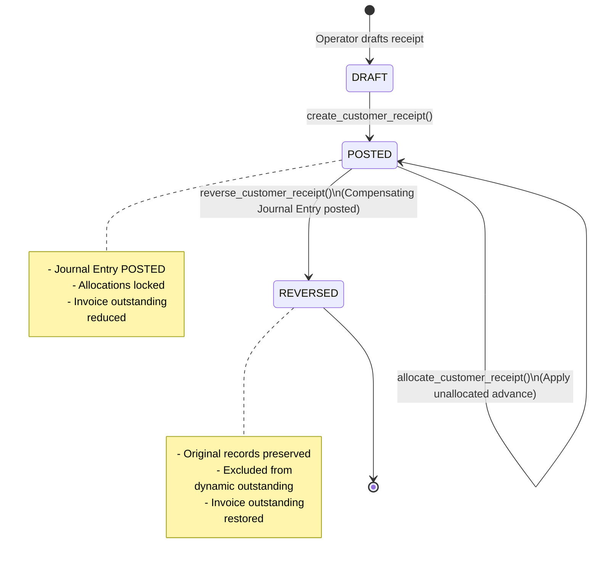

# Anti-Matrix Billing V2 — Phase 3.3: Customer Receipt Backend Service Implementation Report

**Document Version:** 1.0.0  
**Phase:** 3.3 (Customer Receipt Backend Service Implementation)  
**Author:** Senior ERP Backend Engineer  
**Status:** Completed & Fully Verified  
**Date:** 2026-11-17  

---

## Executive Summary

Phase 3.3 implements the core backend service for **Customer Receipt Management** in Traditional Billing (`services/traditional_payment_service.py`). Built upon the database foundations delivered in Phase 3.2 and the double-entry accounting engine from Phase 2/2.1, this service manages receipt voucher generation, multi-mode payment collection, subledger invoice allocation, advance receipt handling, immutable reversals, and authoritative dynamic outstanding calculations.

All operations execute inside **a single atomic transaction**, guaranteeing zero partial writes and zero orphan accounting journals. The service preserves strict physical and logical isolation from Fast Billing, preserves friend-owned module boundaries, and leaves `SaleInvoice` completely unmodified with zero redundant balance columns.

A comprehensive automated test suite ([`tests/traditional/test_traditional_customer_receipts.py`](file:///Users/dhvira/Documents/ANTI%20-%20MATRIX/Billing/tests/traditional/test_traditional_customer_receipts.py)) comprising 24 test scenarios was created and executed, achieving a 100% pass rate. The full Traditional Billing test suite now totals **190 tests**, all passing without regression.

---

## 1. Service Methods & Signatures

The service [`services/traditional_payment_service.py`](file:///Users/dhvira/Documents/ANTI%20-%20MATRIX/Billing/services/traditional_payment_service.py) implements the following methods on `TraditionalPaymentService`:

### 1.1 `create_customer_receipt`
```python
def create_customer_receipt(
    self,
    company_id: str,
    customer_account_id: str,
    deposit_account_id: str,
    total_amount: Union[Decimal, float, int, str],
    payment_method: str = "CASH",
    branch_id: Optional[str] = None,
    receipt_date: Optional[str] = None,
    voucher_number: Optional[str] = None,
    financial_year: Optional[str] = None,
    reference_number: Optional[str] = None,
    reference_date: Optional[str] = None,
    notes: Optional[str] = None,
    idempotency_key: Optional[str] = None,
    allocations: Optional[List[Dict[str, Any]]] = None,
    user_id: Optional[str] = None,
    session: Optional[Session] = None,
) -> Dict[str, Any]
```
- Creates a customer receipt voucher header.
- Allocates funds across zero, one, or multiple sales invoices.
- Computes unallocated balances for advances ($$\text{unallocated} = \text{total} - \text{allocated}$$).
- Posts balanced double-entry accounting journals atomically.
- Records tamper-evident audit logs.

### 1.2 `get_customer_receipt`
```python
def get_customer_receipt(
    self, company_id: str, receipt_id: str, session: Optional[Session] = None
) -> Dict[str, Any]
```
- Retrieves receipt header, allocated totals, and status by receipt UUID.

### 1.3 `get_customer_receipt_details`
```python
def get_customer_receipt_details(
    self, company_id: str, receipt_id: str, session: Optional[Session] = None
) -> Dict[str, Any]
```
- Returns complete receipt information including customer and deposit account metadata, line-item allocations, and double-entry journal linkage.

### 1.4 `list_customer_receipts`
```python
def list_customer_receipts(
    self,
    company_id: str,
    branch_id: Optional[str] = None,
    customer_account_id: Optional[str] = None,
    status: Optional[str] = None,
    payment_method: Optional[str] = None,
    limit: int = 50,
    offset: int = 0,
    session: Optional[Session] = None,
) -> Dict[str, Any]
```
- Filterable and paginated lookup of customer receipts for registers and inquiry screens.

### 1.5 `allocate_customer_receipt`
```python
def allocate_customer_receipt(
    self,
    company_id: str,
    receipt_id: str,
    allocations: List[Dict[str, Any]],
    user_id: Optional[str] = None,
    session: Optional[Session] = None,
) -> Dict[str, Any]
```
- Applies unallocated advance funds from an existing posted receipt to new unpaid invoices.
- Does not create duplicate accounting entries because advance funds were already credited to AR at receipt creation.

### 1.6 `get_customer_invoice_outstanding`
```python
def get_customer_invoice_outstanding(
    self, company_id: str, invoice_id: str, session: Optional[Session] = None
) -> Dict[str, Any]
```
- Computes the live, authoritative outstanding balance for an individual sales invoice dynamically.

### 1.7 `get_customer_outstanding`
```python
def get_customer_outstanding(
    self,
    company_id: str,
    customer_account_id: str,
    as_of_date: Optional[str] = None,
    session: Optional[Session] = None,
) -> Dict[str, Any]
```
- Returns authoritative customer reconciliation: Net General Ledger AR balance, sum of unpaid invoices, and unallocated advance balances.

### 1.8 `reverse_customer_receipt`
```python
def reverse_customer_receipt(
    self,
    company_id: str,
    receipt_id: str,
    reversal_reason: str,
    user_id: Optional[str] = None,
    reversal_date: Optional[str] = None,
    session: Optional[Session] = None,
) -> Dict[str, Any]
```
- Reverses a posted receipt voucher by posting an inverse compensating double-entry journal, marking the receipt `status = "REVERSED"`, preserving allocation history, and automatically restoring invoice outstanding balances.

---

## 2. Customer Receipt Lifecycle



---

## 3. Allocation Calculation Methodology

Per the architectural invariants established in Phase 3.1 and Phase 3.2, `SaleInvoice` does not contain independently maintained `amount_paid` or `outstanding_amount` columns. Instead, invoice outstanding is computed dynamically:

$$\text{Invoice Outstanding} = \text{SaleInvoice.grand\_total} - \sum (\text{ReceiptAllocation.allocated\_amount} + \text{ReceiptAllocation.discount\_amount})$$

**Exclusion Rule**:
The allocation query explicitly filters by `CustomerReceipt.status == 'POSTED'`:

```sql
SELECT 
    COALESCE(SUM(ra.allocated_amount), 0.00),
    COALESCE(SUM(ra.discount_amount), 0.00)
FROM receipt_allocations ra
JOIN customer_receipts cr ON cr.id = ra.receipt_id
WHERE ra.invoice_id = :invoice_id
  AND cr.company_id = :company_id
  AND cr.status = 'POSTED';
```

When a receipt is reversed (`status = 'REVERSED'`), its allocations are immediately excluded from the sum, instantly restoring the invoice's outstanding balance without data mutation.

---

## 4. Accounting Journal Structure

Receipt creation invokes [`TraditionalAccountingService.record_customer_receipt`](file:///Users/dhvira/Documents/ANTI%20-%20MATRIX/Billing/services/traditional_accounting_service.py#L3054-L3110) within the caller's transaction session.

### Example 1: Full Cash Receipt Settlement
- **Receipt Amount**: ₹1,180.00
- **Cash Account**: `CASH`
- **Customer Account**: `Alpha Retailers`
- **Double-Entry Journal**:
  - **Debit**: `Cash in Hand` (`CASH`) — ₹1,180.00
  - **Credit**: `Alpha Retailers` (`CUST_ALPHA`) — ₹1,180.00

### Example 2: Bank Receipt with Cash Discount Allowed
- **Receipt Amount (Net Received)**: ₹1,000.00
- **Cash Discount Allowed**: ₹50.00
- **Total Credit to Customer**: ₹1,050.00
- **Bank Account**: `HDFC Current Account`
- **Double-Entry Journal**:
  - **Debit**: `HDFC Current Account` (`BANK_HDFC`) — ₹1,000.00 (Asset Increase)
  - **Debit**: `Round Off / Discount Allowed` (`ROUND_OFF`) — ₹50.00 (Expense)
  - **Credit**: `Alpha Retailers` (`CUST_ALPHA`) — ₹1,050.00 (Receivable Decrease)
  - **Total Debits**: ₹1,050.00 == **Total Credits**: ₹1,050.00 (Balanced)

### Example 3: Reversal Journal
When receipt is reversed, an inverse compensating journal is posted:
- **Debit**: `Alpha Retailers` (`CUST_ALPHA`) — ₹1,050.00
- **Credit**: `HDFC Current Account` (`BANK_HDFC`) — ₹1,000.00
- **Credit**: `Round Off / Discount Allowed` (`ROUND_OFF`) — ₹50.00

---

## 5. Transaction Atomicity Strategy

To ensure zero orphan journals and complete financial consistency, `TraditionalPaymentService` executes all steps inside a single SQLAlchemy session context:

```python
with self.db.session_scope() as session:
    # 1. Closed accounting period check
    self.accounting_service.validate_period_is_open(company_id, clean_date, session=session)

    # 2. Atomic gapless sequence allocation
    vch_no = self._allocate_voucher_number(session, company_id, branch_id, fy)

    # 3. Create CustomerReceipt header
    session.add(receipt)
    session.flush()

    # 4. Create ReceiptAllocation records
    for alloc in processed_allocations:
        session.add(alloc)
    session.flush()

    # 5. Post accounting journal passing caller session (NO COMMIT)
    journal_res = self.accounting_service.record_customer_receipt(
        ...,
        session=session  # <--- Atomic execution
    )
    receipt.journal_id = journal_res["id"]
    session.flush()

    # 6. AuditLog entry
    session.add(audit_log)
    session.flush()

    # Context manager completes -> single atomic COMMIT executes!
    # On any error -> single atomic ROLLBACK executes!
```

---

## 6. Security & Multi-Tenancy Controls

1. **Company & Branch Context**: Every query and write enforces `company_id` and `branch_id`.
2. **Account Ownership & Type Verification**:
   - Customer accounts must belong to the active company, be active, and have `account_type in ('Debtor', 'Both')`.
   - Deposit accounts must belong to the company, be active, and belong to `GRP_CASH` (for Cash payments) or `GRP_BANK` (for Bank, Cheque, UPI, Card).
   - Incompatible accounts (e.g., Sales, Expense, Supplier) are strictly rejected with `InvalidDepositAccountError`.
3. **Cross-Customer Isolation**: Allocation payloads verify that `invoice.account_id == customer_account_id`. Attempts to allocate Customer A's money to Customer B's invoices raise immediate errors.
4. **Idempotency Guard**: Idempotency keys are scoped per company and deduplicated before any writes.
5. **Period Lock Enforcement**: Closed accounting periods reject new receipts and reversals.

---

## 7. Files Modified & Git Status

### Files Modified & Created
- [`services/traditional_payment_service.py`](file:///Users/dhvira/Documents/ANTI%20-%20MATRIX/Billing/services/traditional_payment_service.py): Created Customer Receipt backend service.
- [`tests/traditional/test_traditional_customer_receipts.py`](file:///Users/dhvira/Documents/ANTI%20-%20MATRIX/Billing/tests/traditional/test_traditional_customer_receipts.py): Created 24-scenario automated test suite.
- [`db/traditional_models.py`](file:///Users/dhvira/Documents/ANTI%20-%20MATRIX/Billing/db/traditional_models.py): Phase 3.2 models and relationships.
- [`traditional_migrations/versions/007_payment_and_receipt_management.py`](file:///Users/dhvira/Documents/ANTI%20-%20MATRIX/Billing/traditional_migrations/versions/007_payment_and_receipt_management.py): Migration script from Phase 3.2.
- [`PHASE_3_1_PAYMENT_RECEIPT_ARCHITECTURE.md`](file:///Users/dhvira/Documents/ANTI%20-%20MATRIX/Billing/PHASE_3_1_PAYMENT_RECEIPT_ARCHITECTURE.md): Architecture blueprint.
- [`PHASE_3_2_PAYMENT_RECEIPT_DATABASE_IMPLEMENTATION.md`](file:///Users/dhvira/Documents/ANTI%20-%20MATRIX/Billing/PHASE_3_2_PAYMENT_RECEIPT_DATABASE_IMPLEMENTATION.md): Database report.

### Git Status
```text
 M db/traditional_models.py
?? PHASE_3_1_PAYMENT_RECEIPT_ARCHITECTURE.md
?? PHASE_3_2_PAYMENT_RECEIPT_DATABASE_IMPLEMENTATION.md
?? services/traditional_payment_service.py
?? tests/traditional/test_traditional_customer_receipts.py
?? tests/traditional/test_traditional_payment_models.py
?? traditional_migrations/versions/007_payment_and_receipt_management.py
```

---

## 8. Automated Test Results

### 8.1 Customer Receipt Test Suite (`tests/traditional/test_traditional_customer_receipts.py`)

All 24 required test scenarios passed with 100% success on disposable databases:

```text
tests/traditional/test_traditional_customer_receipts.py::test_cash_receipt_creation PASSED       [  4%]
tests/traditional/test_traditional_customer_receipts.py::test_bank_receipt_creation PASSED       [  8%]
tests/traditional/test_traditional_customer_receipts.py::test_upi_receipt_creation PASSED        [ 12%]
tests/traditional/test_traditional_customer_receipts.py::test_full_invoice_settlement PASSED    [ 16%]
tests/traditional/test_traditional_customer_receipts.py::test_partial_invoice_settlement PASSED [ 20%]
tests/traditional/test_traditional_customer_receipts.py::test_multiple_invoice_allocations PASSED [ 25%]
tests/traditional/test_traditional_customer_receipts.py::test_partial_allocation PASSED          [ 29%]
tests/traditional/test_traditional_customer_receipts.py::test_advance_receipt PASSED             [ 33%]
tests/traditional/test_traditional_customer_receipts.py::test_unallocated_balance_and_subsequent_allocation PASSED [ 37%]
tests/traditional/test_traditional_customer_receipts.py::test_invoice_outstanding_calculation PASSED [ 41%]
tests/traditional/test_traditional_customer_receipts.py::test_customer_outstanding_calculation PASSED [ 45%]
tests/traditional/test_traditional_customer_receipts.py::test_over_allocation_rejection PASSED   [ 50%]
tests/traditional/test_traditional_customer_receipts.py::test_cross_customer_allocation_rejection PASSED [ 54%]
tests/traditional/test_traditional_customer_receipts.py::test_cross_company_isolation PASSED    [ 58%]
tests/traditional/test_traditional_customer_receipts.py::test_invalid_deposit_account_rejection PASSED [ 62%]
tests/traditional/test_traditional_customer_receipts.py::test_duplicate_idempotency PASSED      [ 66%]
tests/traditional/test_traditional_customer_receipts.py::test_duplicate_voucher_rejection PASSED [ 70%]
tests/traditional/test_traditional_customer_receipts.py::test_accounting_journal_correctness PASSED [ 75%]
tests/traditional/test_traditional_customer_receipts.py::test_transaction_rollback PASSED        [ 79%]
tests/traditional/test_traditional_customer_receipts.py::test_closed_period_rejection PASSED     [ 83%]
tests/traditional/test_traditional_customer_receipts.py::test_receipt_reversal PASSED            [ 87%]
tests/traditional/test_traditional_customer_receipts.py::test_duplicate_reversal_rejection PASSED [ 91%]
tests/traditional/test_traditional_customer_receipts.py::test_reversed_receipt_restores_invoice_outstanding PASSED [ 95%]
tests/traditional/test_traditional_customer_receipts.py::test_concurrent_allocation_safety PASSED [100%]

============================== 24 passed in 5.75s ==============================
```

### 8.2 Full Traditional Regression Suite

Total Traditional test suite executed across accounting, inventory, recovery, voucher numbering, auth, setup token, payment models, and customer receipts:
- **Total Tests Collected**: 190
- **Passed**: 190
- **Failed**: 0
- **Errors**: 0
- **Execution Time**: 43.59s

---

## 9. Known Limitations & Next Steps

1. **Supplier Payments**: Intentionally omitted in Phase 3.3 per instructions; scheduled for Phase 3.4.
2. **Desktop UI & WebBridge**: Customer Receipt screen entry points (`index.html`, `app.js`, `desktop/web_bridge.py`) will be wired after Supplier Payments are complete.
3. **Friend 2 Purchase Integration**: Decoupled and awaiting Friend 2's implementation.

---

## 10. Production Database Integrity Confirmation

The SHA-256 hashes of all production database files were verified before and after test runs:

| Database File | Expected SHA-256 Hash | Actual SHA-256 Hash | Status |
| :--- | :--- | :--- | :--- |
| `data/anti_matrix_billing.db` | `bdd99c65e7431336321adaba2d6276f24caa88cb4bd1a4a62204930fc62061bd` | `bdd99c65e7431336321adaba2d6276f24caa88cb4bd1a4a62204930fc62061bd` | **Unchanged (Intact)** |
| `data/traditional_billing.db` | `0c4e5078625f3f7eef2793e86a5124966800fe7427d456f348a47ad422a57a30` | `0c4e5078625f3f7eef2793e86a5124966800fe7427d456f348a47ad422a57a30` | **Unchanged (Intact)** |
| `data/app.db` | `e3b0c44298fc1c149afbf4c8996fb92427ae41e4649b934ca495991b7852b855` | `e3b0c44298fc1c149afbf4c8996fb92427ae41e4649b934ca495991b7852b855` | **Unchanged (Intact)** |

Zero writes or migrations occurred against production databases. No `.env` secrets were accessed. No commits or pushes were executed.

---

**End of Phase 3.3 Implementation Report.**
