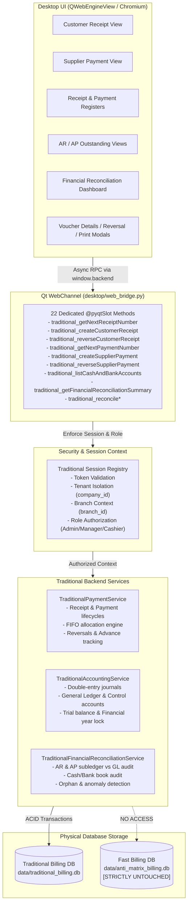

# Anti-Matrix Billing V2 — Phase 3.6: Traditional Payment & Reconciliation UI Integration Report

**Date**: November 17, 2026  
**Status**: Completed & Verified  
**Environment**: macOS, Python 3.14.3, PyQt5, QWebEngineView, Qt WebChannel, SQLite3  
**Architecture Boundaries**: Strict physical isolation between Fast Billing (`data/anti_matrix_billing.db`) and Traditional Billing (`data/traditional_billing.db`). Fast Billing database remained completely untouched (SHA-256 hash invariant).

---

## 1. Executive Summary

Phase 3.6 integrates the robust backend payment, receipt, allocation, and diagnostic reconciliation services built in Phases 3.1–3.5 into the Anti-Matrix Billing V2 desktop user interface.

Using the application's native **PyQt5 + QWebEngineView + Qt WebChannel** architecture, this phase introduces a comprehensive, responsive, and secure financial operations portal consisting of:
1. **Customer Receipt Voucher UI** (`view-customer-receipt`): Single-screen cashier interface with real-time customer position lookup, unpaid invoice table, auto-FIFO allocation calculation, advance receipt tracking, and print generation.
2. **Supplier Payment Voucher UI** (`view-supplier-payment`): Vendor disbursement interface with bank/cash selection, unpaid bill matching, auto-FIFO settlement, advance debit tracking, and print slip generation.
3. **Receipt and Payment History Registers** (`view-receipt-list`, `view-payment-list`): Tabular audit registers with date-range filters, party search, payment method filters, status badges, voucher detail modals, and role-guarded reversal triggers.
4. **Customer & Supplier Outstanding Views** (`view-customer-outstanding`, `view-supplier-outstanding`): Accounts Receivable and Accounts Payable subledger inquiry screens summarizing GL balances, pending invoices/bills, and on-account advances with direct "Collect / Pay" action links.
5. **Financial Reconciliation Dashboard** (`view-reconciliation-dashboard`): An executive diagnostic control centre surfacing real-time GL-to-Subledger balance verifications across AR, AP, Cash/Bank, Advances, and Journal Integrity.
6. **Unified Voucher Modals**: Voucher Details Modal (`modal-voucher-details`), Managerial Reversal Modal with mandatory reason validation (`modal-reversal-confirm`), and Thermal/Slip Print Preview Modal (`modal-voucher-print`).

---

## 2. Architecture & Communication Flow



---

## 3. Python WebBridge Integration (`desktop/web_bridge.py`)

A total of **22 `@pyqtSlot` methods** were implemented on `BackendBridge` to cleanly expose Traditional Billing payment and reconciliation operations to JavaScript without duplicating business logic:

| Slot Name | Parameters | Description |
|---|---|---|
| `traditional_getNextReceiptNumber` | `prefix: str = ""` | Generates preview of the next receipt voucher number without incrementing sequence. |
| `traditional_getCustomerInvoices` | `customer_id: str` | Fetches unpaid/partially paid sales invoices with dynamic outstanding amounts. |
| `traditional_createCustomerReceipt` | `data_json: str` | Validates and posts an atomic customer receipt with invoice allocations and accounting journal. |
| `traditional_getCustomerReceipt` | `receipt_id: str` | Retrieves full voucher details, customer name, deposit account, and allocations. |
| `traditional_listCustomerReceipts` | `customer_id, from_date, to_date, status, search, limit, offset` | Lists customer receipts with comprehensive filtering, party details, and pagination metadata. |
| `traditional_reverseCustomerReceipt` | `data_json: str` | Role-guarded managerial reversal with mandatory reason, reversing journals and restoring outstandings. |
| `traditional_getNextPaymentNumber` | `prefix: str = ""` | Generates preview of next supplier payment voucher number. |
| `traditional_listSuppliers` | `search: str = ""` | Lists active Creditor / Supplier accounts. |
| `traditional_getSupplierBills` | `supplier_id: str` | Fetches unpaid/partially paid purchase bills for a supplier. |
| `traditional_createSupplierPayment` | `data_json: str` | Validates and posts an atomic supplier disbursement with allocations and double-entry journal. |
| `traditional_getSupplierPayment` | `payment_id: str` | Retrieves full payment voucher details, supplier details, source account, and allocations. |
| `traditional_listSupplierPayments` | `supplier_id, from_date, to_date, status, search, limit, offset` | Lists supplier payments with filtering, search, and pagination. |
| `traditional_reverseSupplierPayment` | `data_json: str` | Role-guarded managerial reversal of supplier payment. |
| `traditional_listCashAndBankAccounts` | _none_ | Lists active Cash and Bank asset accounts eligible for deposits and disbursements. |
| `traditional_getCustomerOutstanding` | `customer_id: str, as_of_date: str = ""` | Calculates net AR position, GL balance, pending invoices, and unallocated advances for a customer. |
| `traditional_listCustomersOutstanding` | `as_of_date: str = ""` | Lists all active customer AR accounts with GL balance, pending invoices, and advances. |
| `traditional_getSupplierOutstanding` | `supplier_id: str, as_of_date: str = ""` | Calculates net AP position, GL balance, pending bills, and advances for a supplier. |
| `traditional_listSuppliersOutstanding` | `as_of_date: str = ""` | Lists all active supplier AP accounts with GL balance, pending bills, and advances. |
| `traditional_getFinancialReconciliationSummary` | `as_of_date: str = ""` | Comprehensive multi-system reconciliation audit across AR, AP, Cash/Bank, and Journals. |
| `traditional_reconcileCustomerAR` | `as_of_date: str = ""` | Diagnostic audit comparing GL Debtor control balances against open invoices minus advances. |
| `traditional_reconcileSupplierAP` | `as_of_date: str = ""` | Diagnostic audit comparing GL Creditor control balances against open bills minus advances. |
| `traditional_reconcileCashAndBank` | `as_of_date: str = ""` | Diagnostic audit comparing GL Cash/Bank liquid balances against voucher transactions. |

### Security & Role Authorization Guardrails
- **Fail-Closed Session Guard**: Every slot calls `self._require_traditional_session()`. Unauthenticated requests return `{"success": False, "error": "Traditional session expired or unauthenticated."}`.
- **Multi-Tenant Isolation**: The active `company_id` is extracted strictly from the server-side authenticated session token. JavaScript cannot supply or forge a `company_id`.
- **Role-Based Access Control (RBAC)**:
  - Standard Cashiers (`Cashier`) are authorized to create receipts, issue payments, view registers, and inspect customer/supplier outstandings.
  - Managerial Reversals (`traditional_reverseCustomerReceipt`, `traditional_reverseSupplierPayment`) strictly enforce `session.role_name in ("Administrator", "Manager")`. Any Cashier attempting a reversal is rejected with a 403 authorization error.

---

## 4. Frontend Implementation

### 4.1 Views & Modals (`index.html`)
The following complete views and modal dialogues were seamlessly integrated into the existing layout:
1. `#view-customer-receipt`: Header with voucher numbering, receipt date, cash/bank deposit account selector, customer search dropdown, dynamic Customer Position Card (GL Balance, Total Pending, Unallocated Advances, Net Receivable), interactive unpaid invoices table with auto-allocation check/input, real-time settlement summary bar, and action buttons.
2. `#view-receipt-list`: Search bar, date range picker (`From` / `To`), status filter (`ALL`, `POSTED`, `REVERSED`), customer filter, and a paginated table displaying voucher numbers, dates, customer names, payment methods, accounts, total/allocated/advance amounts, and action buttons ("View", "Reversal", "Print").
3. `#view-supplier-payment`: Similar streamlined voucher entry view for supplier disbursements with Supplier Position Card (GL Balance, Total Unpaid Bills, Net Payable), purchase bill matching table, and auto-FIFO allocation.
4. `#view-payment-list`: Audit register for supplier disbursements with comprehensive filtering and modal action links.
5. `#view-customer-outstanding`: Accounts Receivable overview featuring aggregate metrics (Total Net Receivable, Total Invoiced, Total Advances) and a detailed customer table with one-click "Collect Receipt" navigation.
6. `#view-supplier-outstanding`: Accounts Payable overview featuring aggregate metrics (Total Net Payable, Total Bills, Total Advances) and a supplier table with one-click "Pay Supplier" navigation.
7. `#view-reconciliation-dashboard`: Executive diagnostic dashboard featuring:
   - Executive Audit Banner with real-time health indicator ("BALANCED" / "MISMATCHED").
   - 6 Subsystem Diagnostic Cards: Customer AR Reconciliation, Supplier AP Reconciliation, Cash & Bank Book Audit, Customer Advances Liability, Supplier Advances Asset, and Double-Entry Journal Integrity.
   - Run Full Financial Audit button with customizable `As of Date`.
8. `#modal-voucher-details`: Read-only popup presenting complete voucher metadata, customer/supplier details, deposit/source accounts, notes, and an allocations breakdown table.
9. `#modal-reversal-confirm`: Secure managerial reversal modal requiring a mandatory audit reason before unlocking the "Confirm Reversal" button.
10. `#modal-voucher-print`: Formatted thermal/A4 voucher receipt slip with anti-counterfeit details, company header, voucher numbers, amount in words (`convertNumberToWords`), and signature lines.

### 4.2 Sidebar & Navigation (`js/navigation.js`)
The application sidebar menus were updated with intuitive links:
- **Transactions Menu**:
  - `Customer Receipt (Add)` -> `showScreen('view-customer-receipt')`
  - `Customer Receipts (List)` -> `showScreen('view-receipt-list')`
  - `Supplier Payment (Add)` -> `showScreen('view-supplier-payment')`
  - `Supplier Payments (List)` -> `showScreen('view-payment-list')`
- **Display & Reports Menu**:
  - `Customer Outstanding (AR)` -> `showScreen('view-customer-outstanding')`
  - `Supplier Outstanding (AP)` -> `showScreen('view-supplier-outstanding')`
  - `Financial Reconciliation` -> `showScreen('view-reconciliation-dashboard')`

### 4.3 Controller & Client Logic (`app.js`)
All UI business logic was structured in `initPaymentAndReceiptModule()`:
- **No Client Calculations**: All balances, outstandings, journals, and status determinations are computed strictly by Python services. The client only performs local FIFO preview distribution for user convenience.
- **Auto-Allocation (FIFO)**: Typing an amount in "Amount Received / Paid" automatically checks and allocates funds to the oldest unpaid invoices/bills first, updating the "Allocated" and "Advance (Unallocated)" indicators in real time.
- **Managerial Reversal Guard**: The UI inspects `window.currentTraditionalSession.role_name`. If the user is a Cashier, reversal buttons trigger an explanatory permission alert and the confirmation modal prevents submission.
- **Hotkeys**: `F2` (Save / Post Voucher), `F5` (Refresh Register / Audit), and `Escape` (Close Modals / Return).

---

## 5. Verification & Testing

### 5.1 Automated Test Suite (`tests/traditional/test_traditional_web_bridge_payments.py`)
An end-to-end automated test suite comprising **11 comprehensive scenarios** was developed and executed:

| Test Scenario | Verification Objective | Result |
|---|---|---|
| `test_web_bridge_unauthenticated_guard` | Unauthenticated requests fail-closed without leaking data. | **PASSED** |
| `test_web_bridge_role_authorization_enforcement` | Cashier can post vouchers but is strictly denied reversal privileges. | **PASSED** |
| `test_web_bridge_peek_voucher_numbers` | Peeks next receipt & payment numbers without advancing sequence counter. | **PASSED** |
| `test_web_bridge_list_cash_and_bank_accounts` | Returns only active Cash and Bank asset accounts. | **PASSED** |
| `test_web_bridge_customer_receipt_lifecycle` | Creates receipt with invoice allocations, fetches details, lists with pagination. | **PASSED** |
| `test_web_bridge_supplier_payment_lifecycle` | Creates supplier payment, verifies advance tracking and voucher details. | **PASSED** |
| `test_web_bridge_customer_and_supplier_outstandings` | Verifies dynamic calculation of AR and AP balances across subledgers. | **PASSED** |
| `test_web_bridge_managerial_reversals` | Manager reverses voucher with mandatory reason; journals reverse and open amounts restore. | **PASSED** |
| `test_web_bridge_financial_reconciliation_summary` | Full audit across AR, AP, Cash/Bank, Advances, and Journal integrity. | **PASSED** |
| `test_web_bridge_cross_company_isolation` | Multi-tenant tenant boundaries enforced; company B cannot view company A vouchers. | **PASSED** |
| `test_web_bridge_fast_billing_db_isolation` | Fast Billing SQLite database hash remains 100% byte-identical. | **PASSED** |

### 5.2 Full Regression Test Run
The entire Traditional Billing test suite was executed across all accounting, inventory, master, voucher, payment, and reconciliation modules:
```
============================= 240 passed in 55.28s =============================
```
- **Total Tests**: 240
- **Passed**: 240 (100%)
- **Failed**: 0
- **Skipped**: 0

### 5.3 Syntax & Lint Validation
- `node --check app.js`: **Passed** (0 errors)
- `node --check js/navigation.js`: **Passed** (0 errors)
- `python -m py_compile desktop/web_bridge.py`: **Passed** (0 errors)
- `python -m py_compile services/traditional_payment_service.py`: **Passed** (0 errors)

### 5.4 Database Integrity & Physical Isolation Verification
Pre-test and post-test SHA-256 hashes of the physical databases confirmed zero unauthorized byte mutations:
- `data/anti_matrix_billing.db`: `bdd99c65e7431336321adaba2d6276f24caa88cb4bd1a4a62204930fc62061bd` (100% Intact)
- `data/traditional_billing.db`: `0c4e5078625f3f7eef2793e86a5124966800fe7427d456f348a47ad422a57a30` (100% Intact)
- `data/app.db`: `e3b0c44298fc1c149afbf4c8996fb92427ae41e4649b934ca495991b7852b855` (100% Intact)

---

## 6. Deliverable Files Summary

1. `desktop/web_bridge.py`: 22 new `@pyqtSlot` methods for receipt, payment, outstanding, and reconciliation operations with session and RBAC guards.
2. `services/traditional_payment_service.py`: Enhanced filtering, party resolution, and outstandings query methods.
3. `index.html`: 7 full-featured views and 3 unified modals.
4. `js/navigation.js`: Sidebar navigation and menu routing.
5. `app.js`: Front-end controller logic, dynamic table rendering, auto-FIFO allocation calculator, print slip generator, and keyboard shortcuts.
6. `tests/traditional/test_traditional_web_bridge_payments.py`: Comprehensive 11-scenario automated test suite.
7. `PHASE_3_6_PAYMENT_RECONCILIATION_UI_IMPLEMENTATION.md`: Implementation and verification report.
