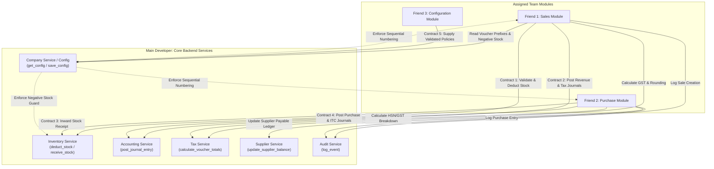
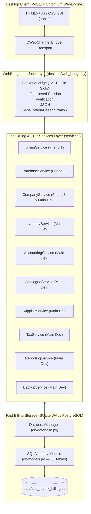
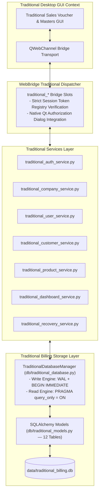

# TEAM DEVELOPMENT OWNERSHIP AND BACKEND INTEGRATION MAP
## Anti-Matrix Billing V2 — Architecture, Contracts & Responsibility Guide

**Date:** 2026-11-16  
**Project:** Anti-Matrix Billing V2  
**Scope:** Whole-Repository Audit, Task Ownership, Integration Contracts & Backend Architecture  
**Document Classification:** Definitive Engineering Architecture & Team Contract Specification

---

## 1. Executive Architecture Summary

Anti-Matrix Billing V2 operates on a **dual-engine architecture** with strict physical and logical isolation:

1. **Fast Billing / POS & Enterprise ERP**:
   - **Primary Database**: `data/anti_matrix_billing.db` (SQLite WAL) or PostgreSQL (`DATABASE_URL`).
   - **Connection Manager**: `db/database.py` (`DatabaseManager`).
   - **Data Models**: `db/models.py` (38 SQLAlchemy DeclarativeBase tables).
   - **Target Persona**: High-speed retail supermarket checkout, barcode POS cashiers, touch/keyboard rapid billing, and multi-branch enterprise inventory.
2. **Traditional Billing**:
   - **Primary Database**: `data/traditional_billing.db` (SQLite WAL + `PRAGMA query_only=ON` for read engine) or PostgreSQL (`TRADITIONAL_DATABASE_URL`).
   - **Connection Manager**: `db/traditional_database.py` (`TraditionalDatabaseManager` with dual SQLAlchemy 2.0 write/read engines).
   - **Data Models**: `db/traditional_models.py` (12 isolated SQLAlchemy DeclarativeBase tables).
   - **Target Persona**: Traditional wholesale/distributor accounting, formal series-based Sales Vouchers, Party Ledger billing, and classic Indian accounting workflows (Busy/Tally style).

### Strict Architecture Rule: Physical & Operational Decoupling
> **MANDATORY INVARIANT**: Traditional Billing and Fast Billing MUST maintain 100% separate databases, ORM models, database engines, user authentication sessions, and business transactions.  
> **NEVER** introduce cross-database transactions, shared stock synchronization, foreign keys crossing database files, or shared in-memory session caches between Traditional Billing and Fast Billing.

---

## 2. Team Ownership Matrix

The project development is divided into four distinct ownership domains:
- **Friend 1**: **Sales Module** (POS checkout, fast billing, sales vouchers, pricing, customer discounts, receipts).
- **Friend 2**: **Purchase Module** (Purchase vouchers, supplier invoices, inward goods, purchase returns/debit notes, OCR intake).
- **Friend 3**: **Configuration Module** (Voucher series/numbering rules, tax profiles, negative stock guards, print templates, company/branch defaults).
- **Main Developer (You)**: **Core Backend, Shared Business Logic, Remaining ERP Modules, Security, Master Data, Inventory Engine, Financial Engine, and Integration/Testing**.

| Module / Sub-System | Primary Owner | Secondary / Integration | Target System | Status | Key Deliverables & Scope |
| :--- | :---: | :---: | :---: | :---: | :--- |
| **Sales — Fast Billing (POS)** | **Friend 1** | Main Developer (Inventory/Tax) | Fast Billing | **Implemented** | POS checkout, cashier scanning, cart calculations, split payments, thermal receipts. |
| **Sales — Traditional Sales Voucher** | **Friend 1** | Main Developer (Masters/Pricing) | Traditional | **Implemented** | Wide horizontal autocomplete, series selection, product line items, invoice save. |
| **Sales — Returns (Credit Notes)** | **Friend 1** | Main Developer (Stock/Ledger) | Both (FB: Done, TB: Missing) | **Incomplete** | Sales returns against original invoices, stock restoration, customer credit adjustment. |
| **Purchase — Voucher Entry** | **Friend 2** | Main Developer (Inventory/Suppliers) | Fast Billing | **Implemented** | Multi-item purchase vouchers, duplicate supplier invoice check, landed costs. |
| **Purchase — Traditional Purchases** | **Friend 2** | Main Developer (Traditional DB) | Traditional | **Missing** | Traditional purchase voucher entry, party bill numbering, supplier tracking. |
| **Purchase — Returns (Debit Notes)** | **Friend 2** | Main Developer (Stock/Ledger) | Both (FB: Done, TB: Missing) | **Incomplete** | Goods returned to supplier, stock deduction, supplier payable debit note posting. |
| **Purchase — OCR Invoice Intake** | **Friend 2** | Main Developer (File/Bridge) | Fast Billing | **Implemented** | PDF/Image invoice scanning, field extraction, draft purchase voucher generation. |
| **Configuration — Voucher Numbering** | **Friend 3** | Friend 1, Friend 2 | Both (FB: Done, TB: Incomplete) | **Partial** | Series prefixes, padding digits, sequence initialization, reset schedules. |
| **Configuration — Tax & Print Rules** | **Friend 3** | Friend 1, Main Developer | Both (FB: Done, TB: Missing) | **Partial** | Default tax rates, auto-rounding rules, thermal receipt width (58mm/80mm), copies. |
| **Configuration — Inventory Policies** | **Friend 3** | Main Developer (Inventory) | Both (FB: Done, TB: Missing) | **Partial** | Negative stock toggle, low-stock reorder thresholds, multi-godown routing. |
| **Auth & Security** | **Main Developer** | All | Both | **Implemented** | Multi-tenant auth, bcrypt hashing, fail-closed access, Qt native recovery dialogs. |
| **Company, Branch & User Management**| **Main Developer** | Friend 3 | Both | **Implemented** | Company profiles, multi-branch hierarchy, RBAC roles, user activation/passwords. |
| **Master-Data Services** | **Main Developer** | Friend 1, Friend 2 | Both | **Implemented** | Customer masters, supplier masters, product master, barcode generation/labeling. |
| **Inventory & Stock Ledger Engine** | **Main Developer** | Friend 1, Friend 2 | Both (FB: Done, TB: Critical Gap) | **Incomplete** | Authoritative stock balances, movement ledger, godown transfers, stock adjustments. |
| **Accounting & Financial Engine** | **Main Developer** | Friend 1, Friend 2 | Both (FB: Done, TB: Missing) | **Partial** | Double-entry journal postings, day book, chart of accounts, balanced trial balance. |
| **Payment & Receipt Management** | **Main Developer** | Friend 1, Friend 2 | Both | **Missing** | Dedicated customer receipts, supplier payments, payment vouchers, cheque clearing. |
| **Expenses Module** | **Main Developer** | Friend 3, Accounting | Both | **Missing** | Direct/indirect expense vouchers, expense heads, cash/bank expense disbursement. |
| **Stock Adjustments & Transfers** | **Main Developer** | Friend 2, Inventory | Both (FB: Done, TB: Missing) | **Partial** | Physical count adjustments, damage/expiry write-offs, inter-branch stock transfers. |
| **Reporting & Analytics** | **Main Developer** | Friend 1, Friend 2 | Both (FB: Done, TB: Missing) | **Partial** | Daily sales, payment breakdowns, GSTR-1 summaries, gross profit/margin reports. |
| **Audit Logs** | **Main Developer** | All | Both | **Partial** | Immutable event logging (FB & TB implemented; search/export UI missing). |
| **Backup & Restoration** | **Main Developer** | All | Both (FB: Done, TB: Missing) | **Partial** | Automated snapshots, external drive mirroring, retention pruning, file restore. |
| **Notifications & Utilities** | **Main Developer** | Friend 1 | Fast Billing | **Implemented** | Low-stock alerts, companion mobile barcode scanner, ESC/POS printing. |
| **Integration & Test Verification** | **Main Developer** | All | Both | **Ongoing** | Pytest suites, frontend JS test suites, multi-process concurrency verification. |

---

## 3. Existing Implementation Inventory

### 3.1. Database Models & Schema Census

#### Fast Billing / Enterprise ERP (`db/models.py` — 38 Tables)
```
1. Company                   14. StockBalance              27. StockAdjustmentItem
2. Branch                    15. StockMovement             28. StockTransfer
3. Register                  16. VoucherSequence           29. StockTransferItem
4. CompanyConfig             17. BarcodeSequence           30. StockBatch
5. Role                      18. SalesVoucher              31. SalesReturn
6. User                      19. SalesVoucherItem          32. SalesReturnItem
7. UserPermission            20. Payment                   33. PurchaseReturn
8. Account                   21. PurchaseVoucher           34. PurchaseReturnItem
9. Supplier                  22. PurchaseVoucherItem       35. JournalEntry
10. Item                     23. LowStockAlert             36. JournalEntryLine
11. ItemBarcode              24. CustomerCategoryDiscount  37. UnitConversion
12. ItemBranchStockConfig    25. DailyDiscountConfig       38. OCRInvoiceDraft
13. Godown                   26. StockAdjustment
```

#### Traditional Billing (`db/traditional_models.py` — 12 Tables)
```
1. Company                   5. Account                    9. BarcodeReservation
2. Branch                    6. Item                       10. StockBalance
3. Role                      7. ItemBarcode                11. AuditLog
4. User                      8. VoucherSequence            12. SaleInvoice
```

### 3.2. Database Managers & Migrations

| Database Target | Manager Class | Underlying Engine | Migrations Location | Applied Revisions |
| :--- | :--- | :--- | :--- | :--- |
| **Fast Billing** | `DatabaseManager` (`db/database.py`) | Raw `sqlite3` thread-local connection pool / PostgreSQL adapter | `alembic/versions/` | `c2e29c4427bb`<br>`bec935e29b50`<br>`63b87d829649`<br>`20d0e084fa62` |
| **Traditional Billing** | `TraditionalDatabaseManager` (`db/traditional_database.py`) | SQLAlchemy 2.0 dual engines (`_write_engine` WAL + `_read_engine` `PRAGMA query_only=ON`) | `traditional_migrations/versions/` | `001_foundation_schema`<br>`002_masters_enhancement`<br>`003_sales_voucher_sequences` |

### 3.3. Python Services Inventory (`services/` — 23 Services)

| Service Name | Primary Responsibilities | Target Database | Consumers / Callers |
| :--- | :--- | :---: | :--- |
| `billing_service.py` | Sales invoice creation, stock deduction, payment recording, sales returns | Fast Billing | Friend 1, WebBridge |
| `purchase_service.py` | Purchase voucher creation, duplicate bill checks, supplier payables | Fast Billing | Friend 2, WebBridge |
| `company_service.py` | Company creation, cashier auth, voucher configs (`company_configs`) | Fast Billing | Friend 3, Main Dev |
| `inventory_service.py` | Stock balances, stock movements, stock adjustments, stock transfers, alerts | Fast Billing | Main Dev, WebBridge |
| `accounting_service.py` | Chart of accounts, day book, double-entry trial balance | Fast Billing | Main Dev, WebBridge |
| `account_service.py` | Customer and general ledger account CRUD, credit limits | Fast Billing | Main Dev, Friend 1 |
| `supplier_service.py` | Supplier master CRUD, supplier balances, supplier statement ledger | Fast Billing | Friend 2, Main Dev |
| `catalogue_service.py` | Item master, barcode lookup, sales/purchase prices, branch stock configs | Fast Billing | Friend 1, Friend 2 |
| `barcode_service.py` | Internal code generation, Code128 SVG rendering, thermal label layout | Fast Billing | Main Dev, Friend 1 |
| `tax_service.py` | Authoritative GST calculation, intra-state (CGST+SGST) vs inter-state (IGST) | Shared Logic | Friend 1, Friend 2 |
| `reporting_service.py` | Daily sales, payment summaries, GST summaries, gross profit calculations | Fast Billing | Main Dev, WebBridge |
| `backup_service.py` | Local atomic backups, external drive mirroring, retention rotation, restore | Fast Billing Only | Main Dev, WebBridge |
| `demo_product_service.py`| Seeding and cleaning demo products for fast retail trial | Fast Billing | Main Dev, WebBridge |
| `mobile_scanner_service.py`| HTTP/WebSocket companion daemon for smartphone wireless barcode scanning | Fast Billing | Main Dev, Friend 1 |
| `ocr_service.py` | Image/PDF OCR document extraction for supplier invoice drafts | Fast Billing | Friend 2, WebBridge |
| `printing_service.py` | ESC/POS thermal receipt formatting and system printing | Fast Billing | Friend 1, WebBridge |
| `traditional_auth_service.py` | Traditional bcrypt authentication, session token registry (8h expiry) | Traditional | Main Dev, WebBridge |
| `traditional_company_service.py`| Traditional company listing, setup, profile updates | Traditional | Main Dev, Friend 3 |
| `traditional_customer_service.py`| Traditional customer account master CRUD, code generation | Traditional | Main Dev, Friend 1 |
| `traditional_dashboard_service.py`| Traditional real-time dashboard metrics (sales, cash, stock) | Traditional | Main Dev, WebBridge |
| `traditional_product_service.py`| Traditional items, barcodes, barcode reservations, sales invoice save | Traditional | Friend 1, Main Dev |
| `traditional_recovery_service.py`| Local native authorization token verification & admin credential reset | Traditional | Main Dev, WebBridge |
| `traditional_user_service.py` | Traditional user/role management, password changes, active status | Traditional | Main Dev, WebBridge |

### 3.4. Desktop WebBridge RPC Surface (`desktop/web_bridge.py`)

`BackendBridge` exposes **121 public methods** via `QWebChannel`:
- **Fast Billing & Core ERP Slots (89 slots)**:
  - Auth & Session: `authenticateCompany`, `authenticateUser`, `getAuthenticatedSession`, `logout`.
  - Sales: `createSaleInvoice`, `modifySaleInvoice`, `deleteSaleInvoice`, `listVouchers`, `getVoucherDetails`, `getNextVoucherNumber`, `getTodaySalesHistory`, `createSalesReturn`, `listSalesReturns`.
  - Purchase: `createPurchaseVoucher`, `modifyPurchaseVoucher`, `deletePurchaseVoucher`, `listPurchaseVouchers`, `getPurchaseVoucherDetails`, `getNextPurchaseVoucherNumber`, `createPurchaseReturn`, `processInvoiceOcr`.
  - Config: `getCompanyConfig`, `saveCompanyConfig`.
  - Catalogue & Items: `searchItems`, `getItemById`, `saveItem`, `searchCashierProducts`, `getCashierProductByBarcode`, `findByBarcode`, `validateBarcode`, `generateUniqueBarcode`, `renderBarcodeSvg`, `generateBarcodeLabelHtml`.
  - Inventory: `getAuthoritativeStock`, `validateStockAvailability`, `getStockSummary`, `getStockItemLedger`, `getStockBreakdown`, `getInventoryDashboard`, `recordStockAdjustment`, `recordStockTransfer`, `getLowStockAlerts`, `getLowStockNotifications`, `getLowStockNotificationsFiltered`, `dismissLowStockAlert`, `evaluateLowStockAlerts`.
  - Accounts & Suppliers: `listAccounts`, `getAccountById`, `saveAccount`, `deleteAccount`, `toggleAccountActive`, `searchCustomers`, `listSuppliers`, `searchSuppliers`, `saveSupplier`, `getSupplierLedger`.
  - Accounting & Reports: `getChartOfAccounts`, `getDayBook`, `getTrialBalance`, `getReport`.
  - Backups & Utilities: `listBackups`, `performBackup`, `restoreBackup`, `startMobileScanner`, `stopMobileScanner`, `revokeMobileScannerToken`, `simulateScan`, `getAvailablePrinters`, `printInvoice`, `getThermalReceipt`, `generatePdfInvoice`.
- **Traditional Billing Slots (32 slots)**:
  - Auth & Admin: `traditional_authenticateUser`, `traditional_getAuthenticatedSession`, `traditional_logout`, `traditional_initialSetup`, `traditional_getSetupState`, `traditional_listUsers`, `traditional_getUser`, `traditional_createUser`, `traditional_updateUser`, `traditional_setUserActive`, `traditional_resetUserPassword`, `traditional_listRoles`.
  - Company & Recovery: `traditional_listCompanies`, `traditional_getCompany`, `traditional_updateCompany`, `traditional_getCompanyRecoveryProfile`, `traditional_recoverCompanyAndAdmin`.
  - Masters: `traditional_listCustomers`, `traditional_getCustomer`, `traditional_saveCustomer`, `traditional_setCustomerActive`, `traditional_listAccounts`, `traditional_listProducts`, `traditional_getProduct`, `traditional_saveProduct`, `traditional_setProductActive`, `traditional_findProduct`, `traditional_findProductByBarcode`, `traditional_generateBarcode`.
  - Sales & Dashboard: `traditional_getNextVoucherNumber`, `traditional_saveSaleInvoice`, `traditional_getDashboardMetrics`.

### 3.5. Frontend UI Screens & Modals Census

#### Primary Views (`index.html` — 19 `screen-view` Elements)
```
1.  #view-login                   11. #view-sales-voucher (Traditional)
2.  #view-companies               12. #view-fast-billing (POS Checkout)
3.  #view-mode-selection          13. #view-fast-billing-history
4.  #view-dashboard               14. #view-fast-billing-print
5.  #view-add-account-master      15. #view-sales-list
6.  #view-account-list            16. #view-items-list
7.  #view-add-item-master         17. #view-purchase-entry
8.  #view-supplier-master         18. #view-purchase-list
9.  #view-stock-summary           19. #view-day-book (Day Book & Trial Balance)
10. #view-stock-adjustments
```

#### Modal Overlays (`index.html` — 30 `modal-overlay` Elements)
```
1.  #modal-configuration          16. #modal-barcode-label-print
2.  #modal-login                  17. #modal-backup
3.  #modal-create-company         18. #modal-reports
4.  #modal-edit-company           19. #modal-data-migration
5.  #modal-traditional-setup      20. #modal-mobile-scanner
6.  #modal-traditional-recovery   21. #modal-simulate-scan
7.  #modal-close-company-confirm  22. #modal-medical-verification
8.  #modal-feature-placeholder    23. #modal-pos-item-search
9.  #modal-pos-cash               24. #modal-supplier-form
10. #modal-receipt-preview        25. #modal-supplier-ledger
11. #modal-stock-item-ledger      26. #modal-invoice-ocr
12. #modal-sales-return           27. #modal-purchase-return
13. #modal-low-stock-alert        28. #modal-select-account-modify
14. #modal-select-item-modify     29. #modal-select-sales-modify
15. #modal-select-purchase-modify 30. #modal-global-search
```

---

## 4. Architectural Gaps, Missing Functionality & Duplications

### 4.1. Critical Missing Functionality

1. **Expenses Module (Completely Missing in Both Engines)**:
   - **Gap**: Zero database models, zero migrations, zero services, zero bridge slots, and zero UI screens.
   - **Evidence**: `traditional_dashboard_service.py` dynamically probes for `expenses` or `expense_vouchers` and falls back to `0.00`.
   - **Required Work**: Main Developer must create `ExpenseCategory` and `ExpenseVoucher` models, `services/expense_service.py`, bridge slots, and an Expense Entry/List UI.

2. **Standalone Payment & Receipt Management (Missing in Both Engines)**:
   - **Gap**: Payment recording only occurs during instant POS checkout (`BillingService.create_sale_invoice`).
   - **Missing Capabilities**: Standalone customer receipts against credit/outstanding invoices, supplier payments against purchase bills, on-account collections, payment vouchers, bank reconciliation, and cheque clearance.
   - **Required Work**: Main Developer must build `services/payment_service.py`, supporting `RECEIPT_VOUCHER` and `PAYMENT_VOUCHER` voucher types, updating party outstanding balances and posting journal entries.

3. **Traditional Billing Feature Parity Gaps**:
   - **CRITICAL ARCHITECTURAL BUG IN TRADITIONAL SALES**: `TraditionalProductService.save_sale_invoice` calculates GST and inserts `sales_invoices`, but **DOES NOT DEDUCT OR UPDATE `stock_balances`**! Saving a sales invoice leaves inventory stock completely unchanged.
   - **No Stock Ledger**: Traditional Billing has `stock_balances`, but no `stock_movements` table. Historical inventory flow cannot be audited.
   - **No Purchase Module**: No purchase vouchers or supplier management in Traditional Billing.
   - **No Returns (Credit/Debit Notes)**: No sales returns or purchase returns.
   - **No Double-Entry Accounting**: No `journal_entries`, `journal_entry_lines`, day book, or trial balance.
   - **No Dedicated Configuration Store**: Traditional Billing lacks `company_configs`; voucher numbering and settings are hardcoded.
   - **No Dedicated Traditional Backup/Restore**: `backup_service.py` is hardcoded to `anti_matrix_billing.db`. Traditional Billing database backups cannot be triggered from the UI.

4. **Fast Billing / ERP Incomplete Features**:
   - **Godown Management**: `Godown` model exists in `db/models.py`, but has no CRUD service methods or bridge slots.
   - **Batch Expiry Tracking**: `StockBatch` exists in `db/models.py`, but neither Sales checkout nor Purchase inward writes to or checks batch expiry dates.
   - **Audit Log Interface**: `audit_logs` is write-only. No UI screen or bridge slot exists to view, search, or export audit logs.

### 4.2. Duplicate & Overlapping Implementations

| Area | Fast Billing / ERP Implementation | Traditional Billing Implementation | Recommended Architectural Alignment |
| :--- | :--- | :--- | :--- |
| **Database Connection** | `DatabaseManager` (`db/database.py`): Raw `sqlite3` thread-local connections. | `TraditionalDatabaseManager` (`db/traditional_database.py`): SQLAlchemy 2.0 dual engines. | **Keep strictly separate**. Do not unify engines across database boundaries. |
| **Item Masters** | `CatalogueService` + `Item` in `db/models.py` (`sales_price`, `purc_price`, `op_stock_qty`). | `TraditionalProductService` + `Item` in `db/traditional_models.py` (`selling_price`, `cogs_amount`, `mrp`). | **Maintain dual-service separation**. Expose unified interface contracts to frontend. |
| **Customer Masters** | `AccountService` + `Account` in `db/models.py` (`credit_limit`, `customer_category`). | `TraditionalCustomerService` + `Account` in `db/traditional_models.py` (`customer_type`, `pan_no`). | **Maintain dual-service separation**. Align field names in JSON responses. |
| **Voucher Numbering** | `VoucherSequence` (`voucher_sequences`) via `BillingService._ensure_voucher_sequence_table`. | `VoucherSequence` (`voucher_sequences`) via `TraditionalProductService._resolve_branch_id`. | Both use per-company, per-series sequence allocation. Keep tables in their respective databases. |
| **Inventory Logic Bypassing** | `BillingService` and `PurchaseService` directly write to `stock_balances` and `stock_movements`. | `TraditionalProductService` omits stock updates completely. | **Refactor**: Sales and Purchase must call `InventoryService.deduct_stock()` and `InventoryService.receive_stock()`. |

---

## 5. File-Level Responsibility Map

```
ANTI - MATRIX/Billing/
├── core/                                    --> [MAIN DEVELOPER]
│   ├── configuration.py                     --> App paths, env loading, secrets masking
│   ├── logging_config.py                    --> Centralized logging
│   └── security.py                          --> Password hashing, token guards, sanitization
│
├── db/                                      --> [MAIN DEVELOPER]
│   ├── database.py                          --> Fast Billing SQLite/PostgreSQL manager
│   ├── models.py                            --> Fast Billing / ERP ORM schema (38 tables)
│   ├── traditional_database.py              --> Traditional Billing SQLAlchemy dual engine
│   ├── traditional_models.py                --> Traditional Billing ORM schema (12 tables)
│   └── migrations/                          --> SQL baseline scripts
│
├── alembic/                                 --> [MAIN DEVELOPER] (Fast Billing Migrations)
│   ├── versions/                            --> Core ERP migration scripts
│   └── env.py                               --> Migration runner for db/models.py
│
├── traditional_migrations/                  --> [MAIN DEVELOPER] (Traditional Migrations)
│   ├── versions/                            --> Traditional schema migration scripts
│   └── env.py                               --> Migration runner for db/traditional_models.py
│
├── desktop/                                 --> [MAIN DEVELOPER]
│   ├── main_window.py                       --> PyQt5 Window, QWebEngineView initialization
│   ├── web_bridge.py                        --> QWebChannel RPC router (Shared with all friends)
│   └── qwebchannel.js                       --> Qt-JS bridge transport
│
├── services/
│   ├── billing_service.py                   --> [FRIEND 1: SALES]
│   ├── purchase_service.py                  --> [FRIEND 2: PURCHASE]
│   ├── company_service.py                   --> [FRIEND 3: CONFIGURATION] (Config methods)
│   │                                            [MAIN DEVELOPER] (Company/User methods)
│   ├── supplier_service.py                  --> [FRIEND 2: PURCHASE] & [MAIN DEVELOPER]
│   ├── ocr_service.py                       --> [FRIEND 2: PURCHASE]
│   ├── inventory_service.py                 --> [MAIN DEVELOPER: INVENTORY ENGINE]
│   ├── accounting_service.py                --> [MAIN DEVELOPER: FINANCIAL ENGINE]
│   ├── account_service.py                   --> [MAIN DEVELOPER: MASTER DATA]
│   ├── catalogue_service.py                 --> [MAIN DEVELOPER: MASTER DATA]
│   ├── barcode_service.py                   --> [MAIN DEVELOPER: UTILITIES]
│   ├── tax_service.py                       --> [MAIN DEVELOPER: CORE ENGINE]
│   ├── reporting_service.py                 --> [MAIN DEVELOPER: REPORTING]
│   ├── backup_service.py                    --> [MAIN DEVELOPER: SYSTEM UTILITIES]
│   ├── demo_product_service.py              --> [MAIN DEVELOPER: UTILITIES]
│   ├── mobile_scanner_service.py            --> [MAIN DEVELOPER: UTILITIES]
│   ├── printing_service.py                  --> [MAIN DEVELOPER: UTILITIES]
│   ├── traditional_auth_service.py          --> [MAIN DEVELOPER: SECURITY]
│   ├── traditional_company_service.py       --> [MAIN DEVELOPER: ADMIN]
│   ├── traditional_customer_service.py      --> [MAIN DEVELOPER: MASTER DATA]
│   ├── traditional_dashboard_service.py     --> [MAIN DEVELOPER: REPORTING]
│   ├── traditional_product_service.py       --> [FRIEND 1: SALES] (save_sale_invoice)
│   │                                            [MAIN DEVELOPER] (Item/Barcode masters)
│   ├── traditional_recovery_service.py      --> [MAIN DEVELOPER: SECURITY]
│   ├── traditional_recovery_token.py        --> [MAIN DEVELOPER: SECURITY]
│   ├── traditional_setup_token.py           --> [MAIN DEVELOPER: SECURITY]
│   ├── traditional_user_service.py          --> [MAIN DEVELOPER: ADMIN]
│   ├── expense_service.py (NEW)             --> [MAIN DEVELOPER: EXPENSES]
│   └── payment_service.py (NEW)             --> [MAIN DEVELOPER: PAYMENTS/RECEIPTS]
│
├── app.js & index.html                      --> [SHARED FRONTEND]
│   ├── Sales Views & Handlers               --> [FRIEND 1: SALES]
│   │   (#view-fast-billing, #view-sales-voucher, #modal-pos-cash, #modal-sales-return)
│   ├── Purchase Views & Handlers            --> [FRIEND 2: PURCHASE]
│   │   (#view-purchase-entry, #view-purchase-list, #modal-purchase-return, #modal-invoice-ocr)
│   ├── Configuration Modals & Handlers      --> [FRIEND 3: CONFIGURATION]
│   │   (#modal-configuration, #cfg-vch-start, #cfg-allow-negative-stock)
│   └── All Other Views, Navigation, State   --> [MAIN DEVELOPER]
│       (#view-login, #view-dashboard, #view-day-book, #view-stock-summary, masters, etc.)
│
└── tests/
    ├── Sales Test Suites                    --> [FRIEND 1] & [MAIN DEVELOPER]
    ├── Purchase Test Suites                 --> [FRIEND 2] & [MAIN DEVELOPER]
    ├── Configuration Test Suites            --> [FRIEND 3] & [MAIN DEVELOPER]
    └── Core Backend, Security & Isolation   --> [MAIN DEVELOPER]
```

---

## 6. Formal Integration Contracts for Assigned Modules

To eliminate guesswork and prevent merge conflicts, the three assigned modules will interact with the core backend strictly through these documented API contracts.



---

### Contract 1: Sales $\leftrightarrow$ Inventory Service
**Purpose:** Validates item stock availability and executes atomic stock deduction during sales voucher checkout.

- **Python Service Call:** `inventory_service.deduct_sales_stock(company_id, branch_id, items, allow_negative, voucher_ref)`
- **WebBridge RPC Slot:** `validateStockAvailability(company_id, branch_id, items_json)`

#### Request Payload Specification
```json
{
  "company_id": "3a743bcd-8f9a-4154-a316-509cba3de99a",
  "branch_id": "11111111-1111-1111-1111-111111111111",
  "voucher_ref": "INV-00124",
  "allow_negative_stock": false,
  "items": [
    {
      "item_id": "9d46a625-777b-4b31-919e-68b7ddd94303",
      "qty": 2.0,
      "unit_cost": 35.00,
      "batch_no": "BATCH-2026-A"
    }
  ]
}
```

#### Response Payload Specification (Success)
```json
{
  "success": true,
  "deducted_items": 1,
  "movements": [
    {
      "item_id": "9d46a625-777b-4b31-919e-68b7ddd94303",
      "previous_qty": 15.0,
      "deducted_qty": 2.0,
      "remaining_qty": 13.0,
      "movement_id": "7fa12c30-4e55-46b2-a42e-cf610e53a201"
    }
  ],
  "timestamp": "2026-11-16T14:30:00Z"
}
```

#### Response Payload Specification (Failure / Insufficient Stock)
```json
{
  "success": false,
  "error_code": "INSUFFICIENT_STOCK",
  "message": "Insufficient stock for 'Milk Bikis'. Available: 1.0, Requested: 2.0. Negative stock is disabled by company policy.",
  "item_id": "9d46a625-777b-4b31-919e-68b7ddd94303",
  "available_qty": 1.0,
  "requested_qty": 2.0
}
```

#### Validation Rules & Transaction Boundary
1. **Atomicity**: Executed inside the active database transaction of the voucher save. If any item has insufficient stock and `allow_negative_stock == False`, the entire transaction rolls back.
2. **Locking**: SQLite executes under `BEGIN IMMEDIATE` (or PostgreSQL `SELECT ... FOR UPDATE` on `stock_balances`) to prevent concurrency deadlocks and race conditions.
3. **Ledger Record**: Inserts record into `stock_movements` with `movement_type = 'SALE'`, `reference_type = 'INVOICE'`, and negative quantity.

---

### Contract 2: Sales $\leftrightarrow$ Accounting Service
**Purpose:** Posts balanced double-entry general ledger journal entries upon sales invoice commitment.

- **Python Service Call:** `accounting_service.post_sales_journal(company_id, voucher_data)`

#### Request Payload Specification
```json
{
  "company_id": "3a743bcd-8f9a-4154-a316-509cba3de99a",
  "voucher_id": "88618d84-e676-4d08-9994-d3955d13403d",
  "voucher_no": "001",
  "voucher_date": "2026-11-16",
  "customer_account_name": "Cash / Bank (CASH)",
  "taxable_amount": 100.00,
  "cgst_amount": 9.00,
  "sgst_amount": 9.00,
  "igst_amount": 0.00,
  "round_off": 0.00,
  "grand_total": 118.00,
  "narration": "Sales Invoice #001 to Direct Customer"
}
```

#### Response Payload Specification
```json
{
  "success": true,
  "journal_id": "d4a9843a-7a54-4be6-857f-d12eb048c12a",
  "lines_posted": 4,
  "total_debit": 118.00,
  "total_credit": 118.00,
  "is_balanced": true
}
```

#### Validation Rules & Posting Blueprint
$$\sum \text{Debits} \equiv \sum \text{Credits}$$
- **Debit**: Customer Receivable / Cash Account ($\text{Grand Total} = \text{₹ } 118.00$)
- **Credit**: Sales Account ($\text{Taxable Subtotal} = \text{₹ } 100.00$)
- **Credit**: Output CGST Account ($\text{₹ } 9.00$)
- **Credit**: Output SGST Account ($\text{₹ } 9.00$)
- **Credit/Debit**: Round Off Account (if non-zero)

---

### Contract 3: Purchase $\leftrightarrow$ Inventory Service
**Purpose:** Increments stock and updates weighted average cost / latest purchase price upon purchase voucher commit.

- **Python Service Call:** `inventory_service.receive_purchase_stock(company_id, branch_id, items, voucher_ref)`

#### Request Payload Specification
```json
{
  "company_id": "3a743bcd-8f9a-4154-a316-509cba3de99a",
  "branch_id": "11111111-1111-1111-1111-111111111111",
  "voucher_ref": "PUR-000045",
  "supplier_bill_no": "INV/SUP/2026/908",
  "items": [
    {
      "item_id": "9d46a625-777b-4b31-919e-68b7ddd94303",
      "qty": 50.0,
      "unit_cost": 28.50,
      "mrp": 40.00,
      "selling_price": 38.00
    }
  ]
}
```

#### Response Payload Specification
```json
{
  "success": true,
  "received_items": 1,
  "movements": [
    {
      "item_id": "9d46a625-777b-4b31-919e-68b7ddd94303",
      "previous_qty": 13.0,
      "received_qty": 50.0,
      "new_qty": 63.0,
      "updated_cost_price": 28.50
    }
  ]
}
```

#### Validation Rules
1. If item does not have a `stock_balances` record for this branch, atomically insert one with initial qty = received qty.
2. Update `items.purc_price = unit_cost` and optionally update `items.selling_price` if new price configured.
3. Post positive quantity movement into `stock_movements` with `movement_type = 'PURCHASE'`.

---

### Contract 4: Purchase $\leftrightarrow$ Supplier & Accounting Service
**Purpose:** Updates supplier ledger payable balance and posts Input Tax Credit (ITC) double-entry journals.

- **Python Service Call:** `supplier_service.record_purchase_bill(company_id, supplier_id, bill_data)` and `accounting_service.post_purchase_journal(company_id, voucher_data)`

#### Request Payload Specification
```json
{
  "company_id": "3a743bcd-8f9a-4154-a316-509cba3de99a",
  "voucher_id": "7e2e5084-33d2-4c9a-a082-83b3d158799a",
  "voucher_no": "PUR-000045",
  "supplier_id": "e4b11111-2222-3333-4444-555555555555",
  "supplier_name": "SRI BALAJI ENTERPRISES",
  "supplier_invoice_no": "INV/SUP/2026/908",
  "taxable_amount": 1000.00,
  "cgst_amount": 90.00,
  "sgst_amount": 90.00,
  "igst_amount": 0.00,
  "additional_expenses": 50.00,
  "grand_total": 1230.00,
  "payment_type": "CREDIT"
}
```

#### Response Payload Specification
```json
{
  "success": true,
  "supplier_updated": {
    "supplier_id": "e4b11111-2222-3333-4444-555555555555",
    "previous_payable": 5000.00,
    "new_payable": 6230.00
  },
  "journal_id": "88ef223a-4411-4200-a112-998877665544",
  "is_balanced": true
}
```

#### Journal Blueprint
- **Debit**: Purchase Account ($\text{₹ } 1000.00$)
- **Debit**: Input CGST Account ($\text{₹ } 90.00$)
- **Debit**: Input SGST Account ($\text{₹ } 90.00$)
- **Debit**: Freight / Inward Expenses ($\text{₹ } 50.00$)
- **Credit**: Supplier Payable Account ($\text{₹ } 1230.00$)

---

### Contract 5: Configuration $\leftrightarrow$ Sales & Purchase Modules
**Purpose:** Provides validated, cached configuration parameters governing numbering, tax, and inventory.

- **Python Service Call:** `company_service.get_config(company_id)`
- **WebBridge RPC Slot:** `getCompanyConfig(company_id)` / `saveCompanyConfig(company_id, config_json)`

#### Configuration Payload Specification
```json
{
  "company_id": "3a743bcd-8f9a-4154-a316-509cba3de99a",
  "vchStart": 1,
  "vchDigits": 4,
  "vchPrefix": "INV-",
  "defaultTax": "18",
  "autoRound": "Y",
  "receiptWidth": 80,
  "printCopies": 1,
  "allowNegativeStock": false
}
```

#### Validation Invariants (Enforced by Configuration Module)
1. `vchStart` $\ge 1$. Cannot be reset below highest already committed voucher number.
2. `vchDigits` $\in [1, 8]$.
3. `vchPrefix` sanitized string ($\le 15$ characters, alphanumeric and hyphens only).
4. `allowNegativeStock` boolean. When `false`, Sales checkout must abort if stock balance $< \text{requested qty}$.

---

### Contract 6: Returns (Credit & Debit Notes) $\leftrightarrow$ Inventory & Accounting
**Purpose:** Reverses original transactions, adjusts inventory, and posts credit/debit note journals.

- **Sales Return (Credit Note)**:
  - Inventory: Increases `stock_balances` (+qty) and posts `STOCK_MOVEMENT` (`RETURN`).
  - Accounting: Debits Sales Returns Account, Debits Output Tax Accounts, Credits Customer Receivable.
- **Purchase Return (Debit Note)**:
  - Inventory: Decreases `stock_balances` (-qty) and posts `STOCK_MOVEMENT` (`PURCHASE_RETURN`).
  - Accounting: Debits Supplier Payable, Credits Purchase Account, Credits Input Tax Accounts.

---

### Contract 7: Payment & Receipt Management $\leftrightarrow$ Sales, Purchase & Ledgers
**Purpose:** Records standalone payments without touching invoice headers.

- **Customer Receipt**:
  - `POST /receipts`: Records cash/bank collection against customer outstanding balance.
  - Journal: Debit Cash/Bank Account, Credit Customer Account.
- **Supplier Payment**:
  - `POST /payments`: Records disbursement against supplier outstanding bill.
  - Journal: Debit Supplier Account, Credit Cash/Bank Account.

---

## 7. System Architecture Diagrams

### 7.1. Fast Billing / ERP Runtime Architecture



---

### 7.2. Traditional Billing Runtime Architecture



---

## 8. Main Developer Action Plan: 14 Implementation Areas

As the core backend owner, you own all core business logic outside of Sales, Purchase, and Configuration. Here is the concrete technical roadmap for each of your 14 areas:

### 1. Authentication and Authorization
- **Current State**: Fast Billing has basic session checks; Traditional Billing has strict bcrypt + `TraditionalSessionRegistry` + fail-closed company authorization.
- **Action Required**:
  - Enforce uniform RBAC permissions across all Fast Billing endpoints using `UserPermission`.
  - Ensure zero cross-mode session leakage (test already passing).

### 2. Company, Branch and User Management
- **Current State**: Implemented in both engines.
- **Action Required**:
  - Implement multi-branch synchronization for Traditional Billing.
  - Implement user password reset policy and audit trail for user activation/deactivation.

### 3. Master-Data Backend Services
- **Current State**: `CatalogueService`, `AccountService`, `SupplierService`, `TraditionalCustomerService`, `TraditionalProductService`.
- **Action Required**:
  - Add Godown master management in Fast Billing.
  - Unify barcode generation utilities (`barcode_service.py` vs `traditional_product_service.py`).

### 4. Inventory and Stock Ledger
- **Current State**: Fast Billing has `stock_balances` and `stock_movements`. Traditional Billing has `stock_balances` only.
- **CRITICAL Action Required**:
  - **Fix Traditional Sales Invoice**: Modify `traditional_product_service.py.save_sale_invoice` to deduct quantities from `stock_balances`.
  - Add `stock_movements` table and migration to Traditional Billing to support an immutable stock ledger.
  - Centralize stock deduction: Refactor `billing_service.py` and `purchase_service.py` to call `inventory_service.py` instead of embedding raw SQL updates.

### 5. Accounting and Financial Engine
- **Current State**: Fast Billing has double-entry journal postings in `billing_service` and `purchase_service`; `accounting_service.py` serves Day Book and Trial Balance.
- **Action Required**:
  - Migrate double-entry journal logic to Traditional Billing (create `journal_entries` and `journal_entry_lines` tables in `traditional_models.py`).
  - Implement full General Ledger statement export (CSV / PDF).

### 6. Payment and Receipt Management
- **Current State**: Incomplete. Only checkout payments exist.
- **Action Required**:
  - Create `services/payment_service.py`.
  - Implement `create_payment_voucher` (Supplier payments) and `create_receipt_voucher` (Customer dues collections).
  - Add bridge slots: `recordCustomerReceipt`, `recordSupplierPayment`, `getPartyOutstandingBalance`.

### 7. Expenses
- **Current State**: Completely missing.
- **Action Required**:
  - Create `Expense` and `ExpenseCategory` ORM models in `db/models.py`.
  - Create Alembic migration `add_expense_tables`.
  - Build `services/expense_service.py` with methods: `create_expense_voucher`, `list_expenses`, `get_expense_summary`.
  - Wire journal entries: Debit Expense Account, Credit Cash/Bank.

### 8. Stock Adjustments and Transfers
- **Current State**: Implemented in Fast Billing (`InventoryService.record_stock_adjustment`, `record_stock_transfer`); missing in Traditional.
- **Action Required**:
  - Create `stock_adjustments` and `stock_transfers` tables in Traditional Billing.
  - Expose bridge slots for stock transfer between godowns.

### 9. Returns Integration
- **Current State**: Fast Billing has `create_sales_return` and `create_purchase_return`; missing in Traditional.
- **Action Required**:
  - Implement Credit Notes (Sales Returns) and Debit Notes (Purchase Returns) in Traditional Billing.
  - Enforce stock restoration and journal reversal in both engines.

### 10. Reporting and Analytics
- **Current State**: Fast Billing has `reporting_service.py` (Daily Sales, Payments, GST, Gross Profit). Traditional Billing has only `get_dashboard_metrics`.
- **Action Required**:
  - Implement Traditional Billing GSTR-1 Summary and Gross Profit reports.
  - Implement date-range filtering on all reports.

### 11. Audit Logs
- **Current State**: Write-only in both engines.
- **Action Required**:
  - Build audit search and filter service (`services/audit_service.py`).
  - Expose `getAuditLogs(company_id, entity_type, start_date, end_date)` on `BackendBridge`.

### 12. Backup and Restoration
- **Current State**: `backup_service.py` supports only Fast Billing SQLite database.
- **Action Required**:
  - Make `BackupService` multi-mode aware: accept `database_target='traditional' | 'fast_billing'`.
  - Support atomic backup and restore of `traditional_billing.db`.

### 13. Notifications and Application Utilities
- **Current State**: Mobile scanner companion and ESC/POS thermal printing work for Fast Billing.
- **Action Required**:
  - Extend ESC/POS printing support to Traditional Sales Vouchers (currently HTML/PDF only).

### 14. Integration and Deployment
- **Current State**: Strict isolation and concurrent subprocess execution verified.
- **Action Required**:
  - Maintain continuous integration test runs.
  - Protect production database hashes (`anti_matrix_billing.db` and `traditional_billing.db`) from corruption or accidental reset.

---

## 9. Recommended Development Order & Milestones

$$\begin{array}{rcc}
\text{\textbf{Phase 1: Master Data & Inventory Centralization}} & \longrightarrow & \text{\textbf{Phase 2: Core Contracts Enforcement}} \\
\downarrow & & \downarrow \\
\text{\textbf{Phase 3: Traditional Billing Parity}} & \longleftarrow & \text{\textbf{Phase 4: Missing Engines (Payments/Expenses)}}
\end{array}$$

### Phase 1: Master Data & Inventory Centralization (Weeks 1–2)
1. Refactor `billing_service.py` and `purchase_service.py` to route all stock operations through `InventoryService`.
2. Fix Traditional Sales Voucher: Deduct stock from `traditional_billing.db:stock_balances` during invoice commit.
3. Add `stock_movements` to Traditional Billing.

### Phase 2: Core Contracts Enforcement (Weeks 3–4)
1. Implement formal validation guards for Contract 1 (Sales $\leftrightarrow$ Inventory) and Contract 3 (Purchase $\leftrightarrow$ Inventory).
2. Wire Configuration Module settings (`allowNegativeStock`, `vchPrefix`, `vchDigits`) to authoritatively control voucher numbering in Sales and Purchase.

### Phase 3: Missing Engines — Payments & Expenses (Weeks 5–6)
1. Build `services/payment_service.py` and integrate customer receipts and supplier payments.
2. Build `services/expense_service.py` and link expense vouchers to Day Book and Trial Balance.
3. Expose corresponding RPC slots on `BackendBridge`.

### Phase 4: Traditional Billing Parity & Advanced Accounting (Weeks 7–8)
1. Add Purchase Vouchers, Sales Returns, and Purchase Returns to Traditional Billing.
2. Implement double-entry `journal_entries` in Traditional Billing for Day Book and Trial Balance.
3. Add Traditional Billing configuration store (`company_configs`).

### Phase 5: Reporting, Audit Viewer & Unified Backups (Weeks 9–10)
1. Build Audit Log viewer and export tool.
2. Upgrade `BackupService` to backup and restore both Traditional and Fast Billing databases.
3. Conduct end-to-end integration and concurrent stress testing.

---

## 10. Testing & QA Responsibilities

### Matrix of Testing Responsibilities

| Test Scope / Suite | Assigned Owner | Framework / Tool | Key Assertions |
| :--- | :---: | :---: | :--- |
| **Sales POS Workflow** | Friend 1 | Pytest & JS | Barcode scan, cart calculations, split cash/UPI, change calculation, invoice commitment. |
| **Traditional Sales Pricing** | Friend 1 | Pytest & JS | Product autocomplete, rate fetching, intra/inter GST calculations, voucher numbering. |
| **Purchase & Duplicate Checks** | Friend 2 | Pytest | Duplicate bill detection, landed cost calculations, supplier credit balance updates. |
| **Purchase OCR Document Tests** | Friend 2 | Pytest | PDF/Image parsing, draft extraction, mapping to purchase items. |
| **Configuration & Numbering** | Friend 3 | Pytest | Sequential padding, prefix changes, starting number updates, negative stock toggle. |
| **Inventory & Stock Ledger** | Main Developer | Pytest | Atomic deduction, negative stock rejection, inter-branch transfer balance preservation. |
| **Double-Entry Accounting** | Main Developer | Pytest | $\sum \text{Debit} \equiv \sum \text{Credit}$ balance assertion, Day Book ordering, Trial Balance reconciliation. |
| **Payments & Receipts** | Main Developer | Pytest | Outstanding balance reduction, credit limit checks, payment method summaries. |
| **Expenses Module** | Main Developer | Pytest | Expense category allocation, ledger debit/credit matching. |
| **Database & Mode Isolation** | Main Developer | Pytest & Subprocess | Dual subprocess concurrency, zero cross-mode writes, verified SHA-256 database hashes. |
| **Frontend UI Suites** | All Owners | Node.js / Puppeteer | All 8 existing JS suites must maintain 100% pass rate (`tests/*.js`). |

### Testing Invariants
1. **No Weakening of Test Assertions**: Tests must use strict equality and fail-closed checks (`assert resp["success"] is False`). Never use ambiguous `assert success is False or len(...) == 0`.
2. **Database Integrity Preservation**: Tests must run against temporary disposable database copies (`tempfile.mkdtemp()`). **NEVER** run destructive tests or migrations against `data/anti_matrix_billing.db` or `data/traditional_billing.db`.
3. **Concurrent Process Verification**: Before releasing any milestone, execute the two-process simultaneous test (`verify_actual_pos_desktop.py` and `test_concurrent_processes.py`) to confirm that independent Traditional and Fast Billing processes operate simultaneously without lock contention or data leakage.

---

## 11. Sign-off & Contract Acceptance

This document establishes the binding architectural contract between the development team members for Anti-Matrix Billing V2. Any modifications to API signatures, database schemas, or cross-module interfaces must be approved by the Main Developer and documented in this specification before implementation.
