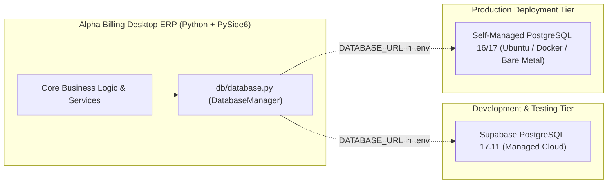

# Alpha Billing V2 — Phase 2 Readiness Report & Final Decision

## 1. Executive Summary

Phase 2 ("Supabase Integration Audit & Database Readiness") has been completed under strict safety protocols. A full read-only inspection of the live **Supabase PostgreSQL** instance, the desktop application startup flow, the codebase database access patterns, and the PostgreSQL compatibility characteristics has been performed.

### Key Audit Findings:
1. **Live Supabase Database Verified**: Direct SSL connectivity to `PostgreSQL 17.11` confirmed. The `public` schema contains **40 tables** holding **12,152 rows** stamped at Alembic revision `63b87d829649`.
2. **Schema Origin Identified**: The 40 tables belong to the **pre-V2 development schema**, not the approved 26-table V2 architecture. None of the 5 new V2 tables (`purchase_payments`, `supplier_allocations`, `product_categories`, `product_units`, `system_backups`) exist yet.
3. **Application Connection Verified**: The desktop application runs through PySide6 / Qt WebChannel with strict frontend isolation. When configured with `DATABASE_URL`, domain services route queries through `DatabaseManager` and `PostgresConnectionAdapter` (Psycopg 3).
4. **Zero Hidden SQLite Fallback**: In PostgreSQL mode, active business services do not write to SQLite. SQLite access is restricted to the historical migration orchestrator in read-only mode (`?mode=ro`).
5. **Historical SQLite Untouched**: The historical SQLite file (`data/anti_matrix_billing.db`) remains 100% untouched (`PRAGMA integrity_check` verified `ok`; 570 sales vouchers, 134 purchase vouchers, 805 items, 364 accounts).
6. **Zero Proprietary Supabase Dependencies**: The application does not use Supabase Auth, Storage, Realtime, or PostgREST. It uses standard PostgreSQL wire protocol over TLS (port 5432). Switching to self-managed production PostgreSQL requires only updating `.env`.

---

## 2. Deliverables Checklist & Document Index

All 7 required Phase 2 documentation deliverables have been created and verified:

| # | Deliverable File | Core Contents & Scope | Status |
|---|---|---|---|
| **1** | [`docs/supabase_existing_database_audit.md`](file:///Users/dhvira/Documents/ANTI%20-%20MATRIX/Billing/docs/supabase_existing_database_audit.md) | Read-only catalog audit: 8 schemas, 40 tables, 12,152 rows, PKs, FKs, constraints, and attribution to previous schema. | **COMPLETED** |
| **2** | [`docs/application_database_connection_audit.md`](file:///Users/dhvira/Documents/ANTI%20-%20MATRIX/Billing/docs/application_database_connection_audit.md) | Runtime trace from `app.py` to `BackendBridge`, services, `DatabaseManager`, pool lifecycle, and Mermaid diagram. | **COMPLETED** |
| **3** | [`docs/legacy_sqlite_usage_audit.md`](file:///Users/dhvira/Documents/ANTI%20-%20MATRIX/Billing/docs/legacy_sqlite_usage_audit.md) | Repository-wide inventory of all `sqlite3.connect`, `sqlite:///`, engine, and session calls across categories A–E. | **COMPLETED** |
| **4** | [`docs/postgresql_compatibility_audit.md`](file:///Users/dhvira/Documents/ANTI%20-%20MATRIX/Billing/docs/postgresql_compatibility_audit.md) | Compatibility analysis: UUIDs, Decimal precision, string vs. native DATE, boolean casting, and voucher sequencing. | **COMPLETED** |
| **5** | [`docs/v2_schema_implementation_gap_report.md`](file:///Users/dhvira/Documents/ANTI%20-%20MATRIX/Billing/docs/v2_schema_implementation_gap_report.md) | Structural delta analysis between 26-table V2 architecture and 40-table legacy schema (5 missing, 18 extraneous tables). | **COMPLETED** |
| **6** | [`docs/postgresql_integration_test_plan.md`](file:///Users/dhvira/Documents/ANTI%20-%20MATRIX/Billing/docs/postgresql_integration_test_plan.md) | 15 isolated integration test workflows with disposable test records, assertions, and execution status. | **COMPLETED** |
| **7** | [`docs/phase_2_readiness_report.md`](file:///Users/dhvira/Documents/ANTI%20-%20MATRIX/Billing/docs/phase_2_readiness_report.md) | Final synthesis, portable architecture validation, and Section 10 readiness classification. | **COMPLETED** |

---

## 3. Portable Database Architecture Evaluation (Section 7)

A primary goal of Alpha Billing V2 is complete independence from cloud provider lock-in:

### Supabase Development vs. Self-Managed Production PostgreSQL

### Verification Against Proprietary Features:
- **Authentication**: Native user table (`users` / `roles` with bcrypt password hashing). Zero dependence on `GoTrue` / Supabase Auth.
- **Storage**: Invoices and backups use local filesystem paths (`data/`, `backups/`). Zero dependence on Supabase Storage (S3 API).
- **Data Transport**: Pure PostgreSQL wire protocol via `psycopg` and `SQLAlchemy 2.x`. Zero dependence on Supabase REST API (`PostgREST`) or Realtime WebSocket server.
- **Security**: Database access authenticated via standard PostgreSQL role credentials with SSL encryption (`sslmode=require` / `verify-full`). Zero dependence on proprietary Supabase client libraries.

---

## 4. Final Classification Decision (Section 10)

Per Section 10 of the Phase 2 specification, the project must be classified into one of the following decisions:
- **A. Ready for V2 PostgreSQL schema creation.**
- **B. Requires database architecture corrections.**
- **C. Requires application integration corrections.**
- **D. Requires both architecture and application corrections.**

---

### **Official Classification: D. Requires both architecture and application corrections**
*(With infrastructure and connectivity categorized as **Ready for V2 PostgreSQL schema creation**)*

#### Detailed Rationale:
1. **Connection & Abstraction Infrastructure (PASS)**:
   - The PostgreSQL connection layer (`core/configuration.py`, `db/database.py`) is verified, stable, and completely portable. It connects to Supabase PostgreSQL 17.11 with zero leaks.
2. **Database Architecture Corrections Required (Category B element)**:
   - The models in `db/models.py` still define the **legacy 39-table layout** (Float monetary fields, String dates, separate `suppliers` and `accounts`, 47 branch entities).
   - The database models must be corrected to match the **26-table V2 architecture** (`NUMERIC(15, 2)`, native `DATE`, unified parties, WAC inventory columns, and 5 new V2 tables).
3. **Application Integration Corrections Required (Category C element)**:
   - Application domain services (`services/account_service.py`, `services/supplier_service.py`, `services/billing_service.py`) currently query legacy tables and columns (e.g. querying `suppliers` separately from `accounts`, or using `WHERE is_active = 1` which will fail on native PostgreSQL `BOOLEAN` columns).
   - Voucher number generation in `billing_service.py` iterates over `sales_vouchers` in Python memory, which must be upgraded to atomic database sequences for concurrency safety.
   - `desktop/main_window.py` requires an explicit `db_manager.dispose()` call in `closeEvent()`.
4. **Next Phase Recommendation**:
   - The environment is fully prepared to execute **Phase 3: V2 Schema Model Realignment and Forward-Only Alembic Migration**.
   - No historical SQLite data migration should be initiated until the V2 schema tables and service layer integrations are fully aligned and tested.
